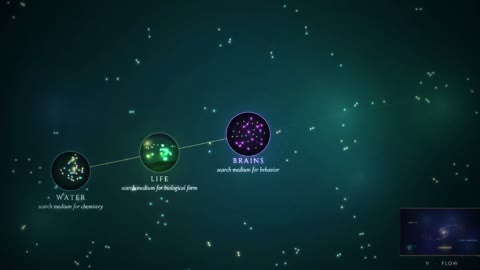

[← Back to gallery](../browse/education.en.md) · [简体中文](2105941630885016018.md)

# Artificial Creativity in Long-Form Procedural Graphics

**[Carlos E. Perez · @IntuitMachine](https://x.com/IntuitMachine)** · Education & explainers · 2059s

> Discovery pool · Source verified; catalog details being completed.

**[▶ Open gallery to play](https://guanmo-ai.github.io/awesome-ai-motion/?lang=en#case-2105941630885016018)** · [Original post](https://x.com/IntuitMachine/status/2105941630885016018)

Click the cover to open the gallery and play.

Particles, nodes and diagrams explore artificial creativity in an approximately thirty-four-minute HTML-generated film.

No public prompt has been verified. [View the original post](https://x.com/IntuitMachine/status/2105941630885016018)

Bookmarks — · Likes — · Views —

## Source record

- Original post: [@IntuitMachine](https://x.com/IntuitMachine/status/2105941630885016018) · 2026-10-02T08:43:05+00:00
- Model attribution: Claude Opus 5.5 · [Creator’s statement](https://x.com/IntuitMachine/status/2105941630885016018)
- Prompt lookup: [Creator post](https://x.com/IntuitMachine/status/2105941630885016018) · 2026-11-02 09:52 UTC
- Cover source: [Original cover source](https://x.com/IntuitMachine/status/2105941630885016018) · 411.74s
- Metrics snapshot: [Original X post](https://x.com/IntuitMachine/status/2105941630885016018) · 2026-11-02 09:15 UTC
- Gallery video source: [Original post media record](https://x.com/IntuitMachine/status/2105941630885016018) · 2026-11-02 09:52 UTC · Post/media correspondence and media response checked; external reference, no re-upload

Model attribution is based on creator statements. Prompts have not been independently rerun; sound and visuals have not received a uniform quality rating. Videos reference original post media, not our uploads; redistribution permission has not been verified.
