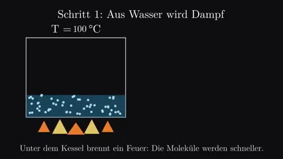

[← 返回图库](../browse/education.md) · [English](2105991032571617500.en.md)

# 蒸汽机如何把往复变为旋转

**[Christopher Meil · @testlandblog](https://x.com/testlandblog)** · 知识讲解 · 125s

> 发现池 · 来源已核对，编目资料待完善。

**[▶ 打开画廊播放](https://guanmo-ai.github.io/awesome-ai-motion/#case-2105991032571617500)** · [作者原帖](https://x.com/testlandblog/status/2105991032571617500)

点击封面打开画廊播放。

加热水箱、气缸、连杆和飞轮逐步连接，解释蒸汽机的运动传递；作者公开了让 Opus 5.5 制作讲解视频的任务。

作者已公开指令；本站仅提供原帖入口，不再分发全文或译文。 [查看作者原文](https://x.com/testlandblog/status/2105991032571617500)

收藏 0 · 点赞 0 · 浏览 36

## 来源记录

- 作品原帖: [@testlandblog](https://x.com/testlandblog/status/2105991032571617500) · 2026-10-02T11:59:24+00:00
- 模型归因: Claude Opus 5.5 · [作者说明](https://x.com/testlandblog/status/2105991032571617500)
- 提示词出处: [作者原帖](https://x.com/testlandblog/status/2105991032571617500) · 2026-10-22 08:51 UTC
- 封面来源: [原帖封面来源](https://x.com/testlandblog/status/2105991032571617500) · 24.99s
- 互动快照: [X 原帖](https://x.com/testlandblog/status/2105991032571617500) · 2026-10-22 08:51 UTC
- 画廊原视频: [原帖媒体记录](https://x.com/testlandblog/status/2105991032571617500) · 2026-10-22 08:51 UTC · 已核对原帖媒体对应与媒体响应；外部引用，不重新上传

模型依据来自作者自述，未独立重跑提示词，也未对音画作统一质量评级。视频引用作者原帖媒体，未由本站重新上传，转载许可未确认。
