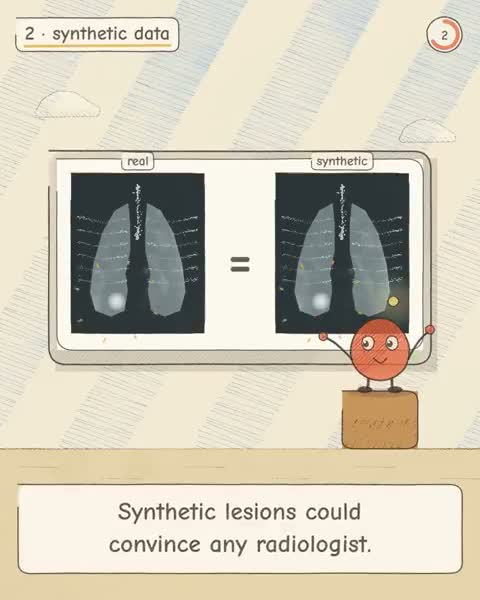

[← Back to gallery](../browse/education.en.md) · [简体中文](2106083299462455731.md)

# Seeing the Unseen: A Drawn Radiology Explainer

**[Woojin Kim · @woojinrad](https://x.com/woojinrad)** · Education & explainers · 65s

> Discovery pool · Source verified; catalog details being completed.

**[▶ Open gallery to play](https://guanmo-ai.github.io/awesome-ai-motion/?lang=en#case-2106083299462455731)** · [Original post](https://x.com/woojinrad/status/2106083299462455731)

Click the cover to open the gallery and play.

Cartoon characters, schematic images and code cards illustrate observations and tests from the creator’s article.

No public prompt has been verified. [View the original post](https://x.com/woojinrad/status/2106083299462455731)

Bookmarks 8 · Likes 18 · Views 1,233

## Source record

- Original post: [@woojinrad](https://x.com/woojinrad/status/2106083299462455731) · 2026-10-02T18:06:02+00:00
- Model attribution: Opus 5.5 · [Creator’s statement](https://x.com/woojinrad/status/2106083299462455731)
- Prompt lookup: [Creator post](https://x.com/woojinrad/status/2106083299462455731) · 2026-10-19 08:47 UTC
- Cover source: [Original cover source](https://x.com/woojinrad/status/2106083299462455731) · 13s
- Metrics snapshot: [Original X post](https://x.com/woojinrad/status/2106083299462455731) · 2026-10-19 08:47 UTC
- Gallery video source: [Original post media record](https://x.com/woojinrad/status/2106083299462455731) · 2026-10-19 08:47 UTC · Post/media correspondence and media response checked; external reference, no re-upload

Model attribution is based on creator statements. Prompts have not been independently rerun; sound and visuals have not received a uniform quality rating. Videos reference original post media, not our uploads; redistribution permission has not been verified.
