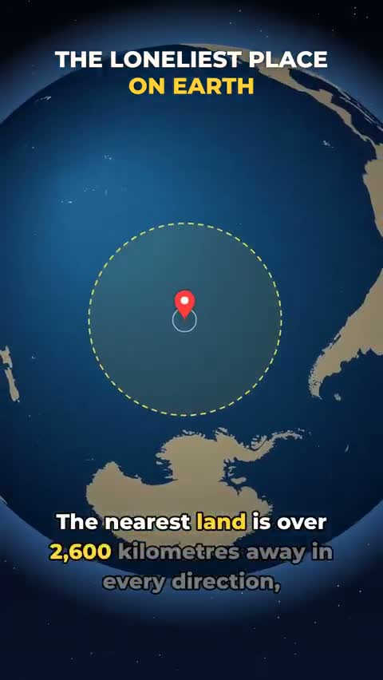

[← 返回图库](../browse/education.md) · [English](2106440528435007643.en.md)

# 尼莫点：地球最孤独地点的数据动画

**[Hari Builds · @hariBuilds\_](https://x.com/hariBuilds_)** · 知识讲解 · 71s

> 发现池 · 来源已核对，编目资料待完善。

**[▶ 打开画廊播放](https://guanmo-ai.github.io/awesome-ai-motion/#case-2106440528435007643)** · [作者原帖](https://x.com/hariBuilds_/status/2106440528435007643)

点击封面打开画廊播放。

地球、定位标记和距离圈依次出现，围绕尼莫点、轨道高度与航天器归宿组织地理数据动画。

未取得作者公开提示词。 [查看作者原帖](https://x.com/hariBuilds_/status/2106440528435007643)

收藏 0 · 点赞 0 · 浏览 77

## 来源记录

- 作品原帖: [@hariBuilds\_](https://x.com/hariBuilds_/status/2106440528435007643) · 2026-10-03T17:45:32+00:00
- 模型归因: Claude Opus 5.5 · [作者说明](https://x.com/hariBuilds_/status/2106440528435007643)
- 提示词查阅记录: [作者原帖](https://x.com/hariBuilds_/status/2106440528435007643) · 2026-10-23 05:30 UTC
- 封面来源: [原帖封面来源](https://x.com/hariBuilds_/status/2106440528435007643) · 14.22s
- 互动快照: [X 原帖](https://x.com/hariBuilds_/status/2106440528435007643) · 2026-10-23 05:30 UTC
- 画廊原视频: [原帖媒体记录](https://x.com/hariBuilds_/status/2106440528435007643) · 2026-10-23 05:30 UTC · 已核对原帖媒体对应与媒体响应；外部引用，不重新上传

模型依据来自作者自述，未独立重跑提示词，也未对音画作统一质量评级。视频引用作者原帖媒体，未由本站重新上传，转载许可未确认。
