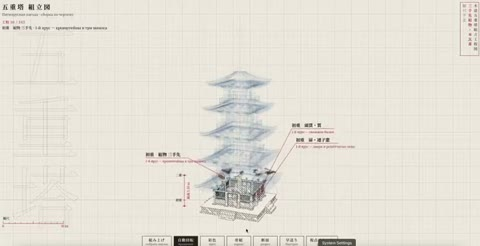

[← Back to gallery](../browse/interactive.en.md) · [简体中文](2106477834873274533.md)

# A Five-Story Pagoda Built from a Blueprint

**[Dannn · @dan\_\_proggg](https://x.com/dan__proggg)** · 3D & interactive · 19s

> Discovery pool · Source verified; catalog details being completed.

**[▶ Open gallery to play](https://guanmo-ai.github.io/awesome-ai-motion/?lang=en#case-2106477834873274533)** · [Original post](https://x.com/dan__proggg/status/2106477834873274533)

Click the cover to open the gallery and play.

A pagoda emerges on a gridded blueprint through wireframes, annotations and assembled structural parts.

No public prompt has been verified. [View the original post](https://x.com/dan__proggg/status/2106477834873274533)

Bookmarks 0 · Likes 2 · Views 150

## Source record

- Original post: [@dan\_\_proggg](https://x.com/dan__proggg/status/2106477834873274533) · 2026-10-03T20:13:46+00:00
- Model attribution: Claude Opus 5.5 · [Creator’s statement](https://x.com/dan__proggg/status/2106477834873274533)
- Prompt lookup: [Creator post](https://x.com/dan__proggg/status/2106477834873274533) · 2026-10-24 12:20 UTC
- Cover source: [Original cover source](https://x.com/dan__proggg/status/2106477834873274533) · 3.89s
- Metrics snapshot: [Original X post](https://x.com/dan__proggg/status/2106477834873274533) · 2026-10-24 12:20 UTC
- Gallery video source: [Original post media record](https://x.com/dan__proggg/status/2106477834873274533) · 2026-10-24 12:20 UTC · Post/media correspondence and media response checked; external reference, no re-upload

Model attribution is based on creator statements. Prompts have not been independently rerun; sound and visuals have not received a uniform quality rating. Videos reference original post media, not our uploads; redistribution permission has not been verified.
