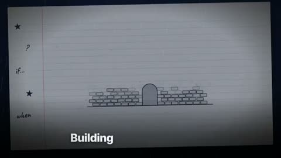

[← Back to gallery](../browse/music.en.md) · [简体中文](2106720729265795579.md)

# A Hand-Drawn Lyric Film for Founders

**[Yaniv Mizrahi · @YanivM79](https://x.com/YanivM79)** · Music & lyrics · 230s

> Discovery pool · Source verified; catalog details being completed.

**[▶ Open gallery to play](https://guanmo-ai.github.io/awesome-ai-motion/?lang=en#case-2106720729265795579)** · [Original post](https://x.com/YanivM79/status/2106720729265795579)

Click the cover to open the gallery and play.

Notebook paper, a brick wall and simplified figures follow lyrics through hand-drawn scenes and shape transitions about building a company.

The creator has shared instructions; this catalog links to the source without redistributing the full text or translation. [Read the creator’s original](https://x.com/YanivM79/status/2106793839193158103)

Bookmarks 0 · Likes 4 · Views 185

## Source record

- Original post: [@YanivM79](https://x.com/YanivM79/status/2106720729265795579) · 2026-10-04T12:18:57+00:00
- Model attribution: Claude Opus 5.5 · [Creator’s statement](https://x.com/YanivM79/status/2106720729265795579)
- Prompt source: [Creator post](https://x.com/YanivM79/status/2106793839193158103) · 2026-10-23 05:30 UTC
- Cover source: [Original cover source](https://x.com/YanivM79/status/2106720729265795579) · 45.98s
- Metrics snapshot: [Original X post](https://x.com/YanivM79/status/2106720729265795579) · 2026-10-23 05:30 UTC
- Gallery video source: [Original post media record](https://x.com/YanivM79/status/2106720729265795579) · 2026-10-23 05:30 UTC · Post/media correspondence and media response checked; external reference, no re-upload

Model attribution is based on creator statements. Prompts have not been independently rerun; sound and visuals have not received a uniform quality rating. Videos reference original post media, not our uploads; redistribution permission has not been verified.
