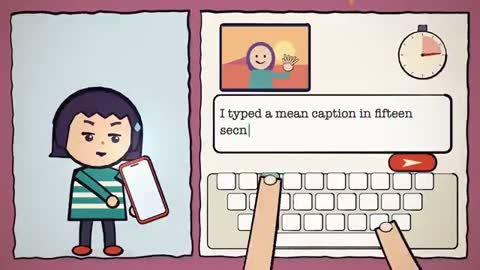

[← 返回图库](../browse/music.md) · [English](2106772719614234885.en.md)

# 纸片角色与拒绝恶评的音乐动画

**[theWEVR · @thewevr](https://x.com/thewevr)** · 音乐与歌词 · 200s

> 发现池 · 来源已核对，编目资料待完善。

**[▶ 打开画廊播放](https://guanmo-ai.github.io/awesome-ai-motion/#case-2106772719614234885)** · [作者原帖](https://x.com/thewevr/status/2106772719614234885)

点击封面打开画廊播放。

纸片卡通角色、键盘和大字歌词反复变换，围绕一条恶意评论组织完整歌曲的视觉叙事。

作者已公开指令；本站仅提供原帖入口，不再分发全文或译文。 [查看作者原文](https://x.com/thewevr/status/2106774417732681887)

收藏 0 · 点赞 0 · 浏览 1,734

## 来源记录

- 作品原帖: [@thewevr](https://x.com/thewevr/status/2106772719614234885) · 2026-10-04T15:45:32+00:00
- 模型归因: Claude Opus 5.5 · [作者说明](https://x.com/thewevr/status/2106772719614234885)
- 提示词出处: [作者原帖](https://x.com/thewevr/status/2106774417732681887) · 2026-10-23 05:30 UTC
- 封面来源: [原帖封面来源](https://x.com/thewevr/status/2106772719614234885) · 39.98s
- 互动快照: [X 原帖](https://x.com/thewevr/status/2106772719614234885) · 2026-10-23 05:30 UTC
- 画廊原视频: [原帖媒体记录](https://x.com/thewevr/status/2106772719614234885) · 2026-10-23 05:30 UTC · 已核对原帖媒体对应与媒体响应；外部引用，不重新上传

模型依据来自作者自述，未独立重跑提示词，也未对音画作统一质量评级。视频引用作者原帖媒体，未由本站重新上传，转载许可未确认。
