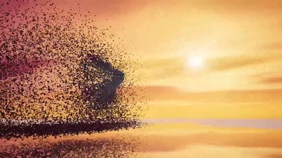

[← Back to gallery](../browse/interactive.en.md) · [简体中文](2106848293678620860.md)

# Obsidian: Monolith, Cathedral and Whale

**[Techartist · @techartist\_](https://x.com/techartist_)** · 3D & interactive · 18s

> Discovery pool · Source verified; catalog details being completed.

**[▶ Open gallery to play](https://guanmo-ai.github.io/awesome-ai-motion/?lang=en#case-2106848293678620860)** · [Original post](https://x.com/techartist_/status/2106848293678620860)

Click the cover to open the gallery and play.

[Matching film source](https://github.com/iamtechartist/obsidian) · [Creator demo](https://iamtechartist.github.io/obsidian/)

Procedural fragments transform a monolith into a cathedral and a whale. The creator credits Opus 5.5 and Three.js and publishes the matching project under MIT.

## Source & web pages

- **Direct source**：[Matching film source](https://github.com/iamtechartist/obsidian) · [MIT](https://github.com/iamtechartist/obsidian/blob/main/LICENSE)
  [Link source](https://x.com/techartist_/status/2106848293678620860) · Link checked 2026-10-15 10:24 UTC
- **Public web page**：[Creator demo](https://iamtechartist.github.io/obsidian/)
  [Link source](https://github.com/iamtechartist/obsidian) · Link checked 2026-10-15 10:24 UTC

No public prompt has been verified. [View the original post](https://x.com/techartist_/status/2106848293678620860)

Bookmarks 44 · Likes 118 · Views 5,182

## Source record

- Original post: [@techartist\_](https://x.com/techartist_/status/2106848293678620860) · 2026-10-04T20:45:51+00:00
- Model attribution: Opus 5.5 · [Creator’s statement](https://x.com/techartist_/status/2106848293678620860)
- Prompt lookup: [Creator post](https://x.com/techartist_/status/2106848293678620860) · 2026-10-15 06:14 UTC
- Cover source: [Original cover source](https://x.com/techartist_/status/2106848293678620860) · 9.9s
- Metrics snapshot: [Original X post](https://x.com/techartist_/status/2106848293678620860) · 2026-10-15 06:14 UTC
- Gallery video source: [Original post media record](https://x.com/techartist_/status/2106848293678620860) · 2026-10-15 06:14 UTC · Post/media correspondence and media response checked; external reference, no re-upload

Model attribution is based on creator statements. Prompts have not been independently rerun; sound and visuals have not received a uniform quality rating. Videos reference original post media, not our uploads; redistribution permission has not been verified.
