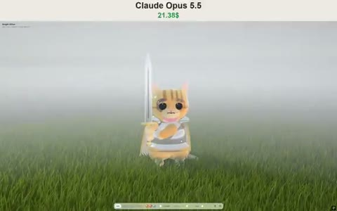

[← Back to gallery](../browse/characters.en.md) · [简体中文](2106887740310651320.md)

# A Jelly Cat Knight with a Moving Cape

**[Vib3Coded · @vib3coded](https://x.com/vib3coded)** · Pixel art & characters · 18s

> Discovery pool · Source verified; catalog details being completed.

**[▶ Open gallery to play](https://guanmo-ai.github.io/awesome-ai-motion/?lang=en#case-2106887740310651320)** · [Original post](https://x.com/vib3coded/status/2106887740310651320)

Click the cover to open the gallery and play.

A translucent cat knight stands in grass with armor, a sword and a moving cape, using procedural models and textures according to the creator.

No public prompt has been verified. [View the original post](https://x.com/vib3coded/status/2106887740310651320)

Bookmarks 17 · Likes 68 · Views 4,281

## Source record

- Original post: [@vib3coded](https://x.com/vib3coded/status/2106887740310651320) · 2026-10-04T23:22:36+00:00
- Model attribution: Claude Opus 5.5 · [Creator’s statement](https://x.com/vib3coded/status/2106887740310651320)
- Prompt lookup: [Creator post](https://x.com/vib3coded/status/2106887740310651320) · 2026-10-22 08:51 UTC
- Cover source: [Original cover source](https://x.com/vib3coded/status/2106887740310651320) · 3.6s
- Metrics snapshot: [Original X post](https://x.com/vib3coded/status/2106887740310651320) · 2026-10-22 08:51 UTC
- Gallery video source: [Original post media record](https://x.com/vib3coded/status/2106887740310651320) · 2026-10-22 08:51 UTC · Post/media correspondence and media response checked; external reference, no re-upload

Model attribution is based on creator statements. Prompts have not been independently rerun; sound and visuals have not received a uniform quality rating. Videos reference original post media, not our uploads; redistribution permission has not been verified.
