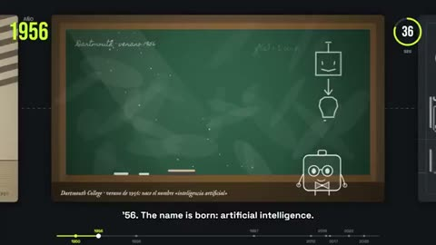

[← 返回图库](../browse/education.md) · [English](2107274640431456454.en.md)

# 45 秒 AI 简史：黑板到 Transformer

**[IA en Crudo · @IAenCrudo](https://x.com/IAenCrudo)** · 知识讲解 · 45s

> 发现池 · 来源已核对，编目资料待完善。

**[▶ 打开画廊播放](https://guanmo-ai.github.io/awesome-ai-motion/#case-2107274640431456454)** · [作者原帖](https://x.com/IAenCrudo/status/2107274640431456454)

点击封面打开画廊播放。

黑板、图形与卡通角色依次穿过人工智能发展的阶段。

未取得作者公开提示词。 [查看作者原帖](https://x.com/IAenCrudo/status/2107274640431456454)

收藏 0 · 点赞 0 · 浏览 45

## 来源记录

- 作品原帖: [@IAenCrudo](https://x.com/IAenCrudo/status/2107274640431456454) · 2026-10-06T01:00:00+00:00
- 模型归因: Opus 5.5 · [作者说明](https://x.com/IAenCrudo/status/2107274640431456454)
- 提示词查阅记录: [作者原帖](https://x.com/IAenCrudo/status/2107274640431456454) · 2026-10-16 07:20 UTC
- 封面来源: [原帖封面来源](https://x.com/IAenCrudo/status/2107274640431456454) · 9.01s
- 互动快照: [X 原帖](https://x.com/IAenCrudo/status/2107274640431456454) · 2026-10-16 07:20 UTC
- 画廊原视频: [原帖媒体记录](https://x.com/IAenCrudo/status/2107274640431456454) · 2026-10-16 07:20 UTC · 已核对原帖媒体对应与媒体响应；外部引用，不重新上传

模型依据来自作者自述，未独立重跑提示词，也未对音画作统一质量评级。视频引用作者原帖媒体，未由本站重新上传，转载许可未确认。
