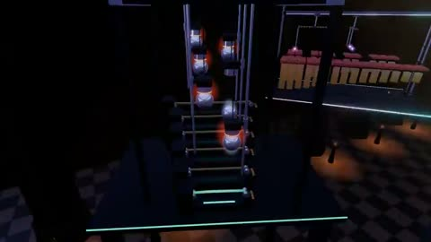

[← Back to gallery](../browse/music.en.md) · [简体中文](2107637301488836782.md)

# Another Mechanical Music Machine

**[A.J. · @aj\_dev\_smith](https://x.com/aj_dev_smith)** · Music & lyrics · 104s

> Discovery pool · Source verified; catalog details being completed.

**[▶ Open gallery to play](https://guanmo-ai.github.io/awesome-ai-motion/?lang=en#case-2107637301488836782)** · [Original post](https://x.com/aj_dev_smith/status/2107637301488836782)

Click the cover to open the gallery and play.

Marbles strike xylophones, bells and other mechanical instruments.

No public prompt has been verified. [View the original post](https://x.com/aj_dev_smith/status/2107637301488836782)

Bookmarks 17 · Likes 38 · Views 1,536

## Source record

- Original post: [@aj\_dev\_smith](https://x.com/aj_dev_smith/status/2107637301488836782) · 2026-10-07T01:01:05+00:00
- Model attribution: Opus 5.5 · [Creator’s statement](https://x.com/aj_dev_smith/status/2107637301488836782)
- Prompt lookup: [Creator post](https://x.com/aj_dev_smith/status/2107637301488836782) · 2026-10-16 06:56 UTC
- Cover source: [Original cover source](https://x.com/aj_dev_smith/status/2107637301488836782) · 20.85s
- Metrics snapshot: [Original X post](https://x.com/aj_dev_smith/status/2107637301488836782) · 2026-10-16 06:56 UTC
- Gallery video source: [Original post media record](https://x.com/aj_dev_smith/status/2107637301488836782) · 2026-10-16 06:56 UTC · Post/media correspondence and media response checked; external reference, no re-upload

Model attribution is based on creator statements. Prompts have not been independently rerun; sound and visuals have not received a uniform quality rating. Videos reference original post media, not our uploads; redistribution permission has not been verified.
