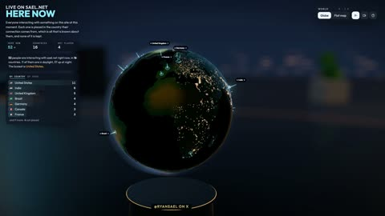

[← Back to gallery](../browse/interactive.en.md) · [简体中文](2107683152865173619.md)

# Live Visitors Become Spheres and Islands

**[Ryan Sael · @RyanSael](https://x.com/RyanSael)** · 3D & interactive · 30s

> Discovery pool · Source verified; catalog details being completed.

**[▶ Open gallery to play](https://guanmo-ai.github.io/awesome-ai-motion/?lang=en#case-2107683152865173619)** · [Original post](https://x.com/RyanSael/status/2107683152865173619)

Click the cover to open the gallery and play.

[Live-visitor 3D demo](https://sael.net/here)

Visitor data maps to spheres and islands, turning live information into changing 3D graphics.

## Source & web pages

- **Public web page**：[Live-visitor 3D demo](https://sael.net/here)
  [Link source](https://x.com/RyanSael/status/2107683152865173619) · Link checked 2026-11-02 09:52 UTC

No public prompt has been verified. [View the original post](https://x.com/RyanSael/status/2107683152865173619)

Bookmarks — · Likes — · Views —

## Source record

- Original post: [@RyanSael](https://x.com/RyanSael/status/2107683152865173619) · 2026-10-07T04:03:17+00:00
- Model attribution: Claude Opus 5.5 · [Creator’s statement](https://x.com/RyanSael/status/2107683152865173619)
- Prompt lookup: [Creator post](https://x.com/RyanSael/status/2107683152865173619) · 2026-11-02 09:52 UTC
- Cover source: [Original cover source](https://x.com/RyanSael/status/2107683152865173619) · 6s
- Metrics snapshot: [Original X post](https://x.com/RyanSael/status/2107683152865173619) · 2026-11-02 09:19 UTC
- Gallery video source: [Original post media record](https://x.com/RyanSael/status/2107683152865173619) · 2026-11-02 09:52 UTC · Post/media correspondence and media response checked; external reference, no re-upload

Model attribution is based on creator statements. Prompts have not been independently rerun; sound and visuals have not received a uniform quality rating. Videos reference original post media, not our uploads; redistribution permission has not been verified.
