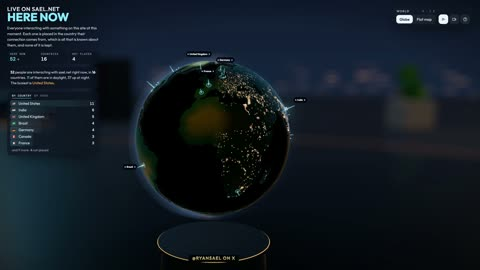

[← 返回图库](../browse/interactive.md) · [English](2107683152865173619.en.md)

# 实时访客变成球体与岛屿

**[Ryan Sael · @RyanSael](https://x.com/RyanSael)** · 交互演示 · 30s

> 发现池 · 来源已核对，编目资料待完善。

**[▶ 打开画廊播放](https://guanmo-ai.github.io/awesome-ai-motion/#case-2107683152865173619)** · [作者原帖](https://x.com/RyanSael/status/2107683152865173619)

点击封面打开画廊播放。

[实时访客三维演示](https://sael.net/here)

访客数据映射为球体与岛屿，让实时信息成为可变化的三维图形。

## 源码与网页

- **公开网页**：[实时访客三维演示](https://sael.net/here)
  [链接出处](https://x.com/RyanSael/status/2107683152865173619) · 链接核对 2026-11-02 09:52 UTC

未取得作者公开提示词。 [查看作者原帖](https://x.com/RyanSael/status/2107683152865173619)

收藏 — · 点赞 — · 浏览 —

## 来源记录

- 作品原帖: [@RyanSael](https://x.com/RyanSael/status/2107683152865173619) · 2026-10-07T04:03:17+00:00
- 模型归因: Claude Opus 5.5 · [作者说明](https://x.com/RyanSael/status/2107683152865173619)
- 提示词查阅记录: [作者原帖](https://x.com/RyanSael/status/2107683152865173619) · 2026-11-02 09:52 UTC
- 封面来源: [原帖封面来源](https://x.com/RyanSael/status/2107683152865173619) · 6s
- 互动快照: [X 原帖](https://x.com/RyanSael/status/2107683152865173619) · 2026-11-02 09:19 UTC
- 画廊原视频: [原帖媒体记录](https://x.com/RyanSael/status/2107683152865173619) · 2026-11-02 09:52 UTC · 已核对原帖媒体对应与媒体响应；外部引用，不重新上传

模型依据来自作者自述，未独立重跑提示词，也未对音画作统一质量评级。视频引用作者原帖媒体，未由本站重新上传，转载许可未确认。
