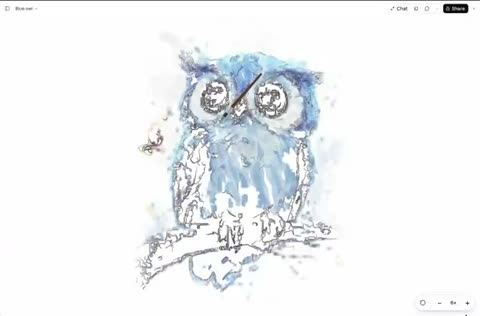

[← Back to gallery](../browse/characters.en.md) · [简体中文](2107802810234659189.md)

# A Watercolor Owl and a Butterfly

**[The Bugged Dev · @thebuggeddev](https://x.com/thebuggeddev)** · Pixel art & characters · 48s

> Discovery pool · Source verified; catalog details being completed.

**[▶ Open gallery to play](https://guanmo-ai.github.io/awesome-ai-motion/?lang=en#case-2107802810234659189)** · [Original post](https://x.com/thebuggeddev/status/2107802810234659189)

Click the cover to open the gallery and play.

A watercolor owl emerges through drawing, with breathing, eye and butterfly movements.

No public prompt has been verified. [View the original post](https://x.com/thebuggeddev/status/2107802810234659189)

Bookmarks 113 · Likes 192 · Views 9,373

## Source record

- Original post: [@thebuggeddev](https://x.com/thebuggeddev/status/2107802810234659189) · 2026-10-07T11:58:45+00:00
- Model attribution: Opus 5.5 · [Creator’s statement](https://x.com/thebuggeddev/status/2107802810234659189)
- Prompt lookup: [Creator post](https://x.com/thebuggeddev/status/2107802810234659189) · 2026-10-19 08:47 UTC
- Cover source: [Original cover source](https://x.com/thebuggeddev/status/2107802810234659189) · 9.62s
- Metrics snapshot: [Original X post](https://x.com/thebuggeddev/status/2107802810234659189) · 2026-10-19 08:47 UTC
- Gallery video source: [Original post media record](https://x.com/thebuggeddev/status/2107802810234659189) · 2026-10-19 08:47 UTC · Post/media correspondence and media response checked; external reference, no re-upload

Model attribution is based on creator statements. Prompts have not been independently rerun; sound and visuals have not received a uniform quality rating. Videos reference original post media, not our uploads; redistribution permission has not been verified.
