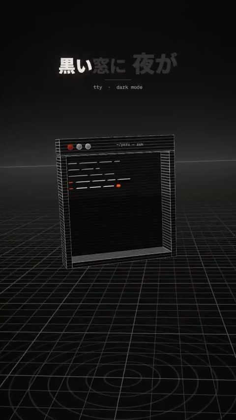

[← Back to gallery](../browse/music.en.md) · [简体中文](2107826563786084783.md)

# A Vertical Lyric MV in Engraved 3D Lines

**[おず＠経営者向けClaudeCode講座 · @okazaky](https://x.com/okazaky)** · Music & lyrics · 51s

> Discovery pool · Source verified; catalog details being completed.

**[▶ Open gallery to play](https://guanmo-ai.github.io/awesome-ai-motion/?lang=en#case-2107826563786084783)** · [Original post](https://x.com/okazaky/status/2107826563786084783)

Click the cover to open the gallery and play.

[This film’s storyboard, scenes and revision notes](https://github.com/okazaky/claude-skill-lyric-mv-3d/tree/main/examples/yoru-code)

Black, bone and orange lines construct text, spheres and a city, with scene changes aligned to lyrics and real stem onsets; the song was made with Suno.

## Source & web pages

- **Direct source**：[This film’s storyboard, scenes and revision notes](https://github.com/okazaky/claude-skill-lyric-mv-3d/tree/main/examples/yoru-code) · [MIT](https://github.com/okazaky/claude-skill-lyric-mv-3d/blob/main/LICENSE)
  Adapted from Giacomo Magnanini’s mexicat/pdoom-video. Song and lyric files are excluded; the code license does not cover those assets.
  [Link source](https://x.com/okazaky/status/2107826563786084783) · Link checked 2026-11-02 08:50 UTC

## What to learn

Separate the audio stems and verify real onsets so lyrics, scenes and musical changes share one timeline.

**Try it yourself** · Editorial suggestions based on public source material, not a complete record of the creator’s process.

1. Separate vocals, drums and other stems and check lyric timing.
2. Design 3D scenes line by line with deterministic time-based rendering.
3. Correct transitions against actual musical onsets, then render.

Tools mentioned in the source：Opus 5.5 · Three.js · Suno · Demucs · mlx\_whisper · FFmpeg

[Source 1](https://x.com/okazaky/status/2107826563786084783)

No public prompt has been verified. [View the original post](https://x.com/okazaky/status/2107826563786084783)

Bookmarks — · Likes — · Views —

## Source record

- Original post: [@okazaky](https://x.com/okazaky/status/2107826563786084783) · 2026-10-07T13:33:08+00:00
- Model attribution: Claude Opus 5.5 · [Creator’s statement](https://x.com/okazaky/status/2107826563786084783)
- Prompt lookup: [Creator post](https://x.com/okazaky/status/2107826563786084783) · 2026-11-02 08:50 UTC
- Cover source: [Original cover source](https://x.com/okazaky/status/2107826563786084783) · 10.18s
- Metrics snapshot: [Original X post](https://x.com/okazaky/status/2107826563786084783) · 2026-11-02 08:47 UTC
- Gallery video source: [Original post media record](https://x.com/okazaky/status/2107826563786084783) · 2026-11-02 08:50 UTC · Post/media correspondence and media response checked; external reference, no re-upload

Model attribution is based on creator statements. Prompts have not been independently rerun; sound and visuals have not received a uniform quality rating. Videos reference original post media, not our uploads; redistribution permission has not been verified.
