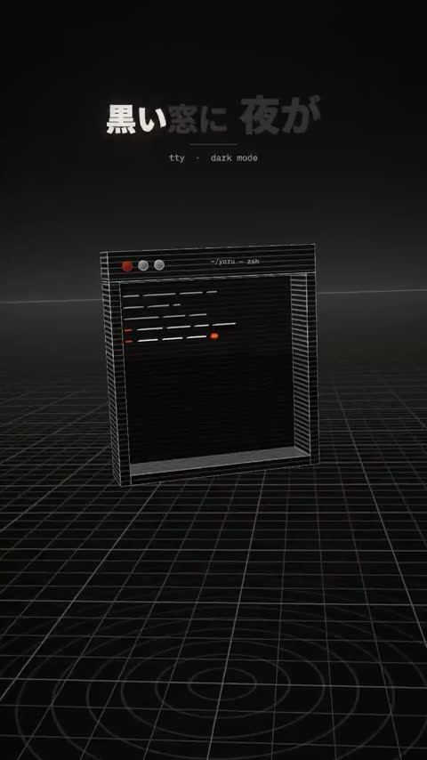

[← 返回图库](../browse/music.md) · [English](2107826563786084783.en.md)

# 铜版画线条构成的竖屏歌词 MV

**[おず＠経営者向けClaudeCode講座 · @okazaky](https://x.com/okazaky)** · 音乐与歌词 · 51s

> 发现池 · 来源已核对，编目资料待完善。

**[▶ 打开画廊播放](https://guanmo-ai.github.io/awesome-ai-motion/#case-2107826563786084783)** · [作者原帖](https://x.com/okazaky/status/2107826563786084783)

点击封面打开画廊播放。

[本片分镜、场景代码与修改记录](https://github.com/okazaky/claude-skill-lyric-mv-3d/tree/main/examples/yoru-code)

黑、骨白与橙色的线条构成文字、球体和城市，场景切换跟随歌词与分离音轨中的真实起音；歌曲由 Suno 制作。

## 源码与网页

- **直接源码**：[本片分镜、场景代码与修改记录](https://github.com/okazaky/claude-skill-lyric-mv-3d/tree/main/examples/yoru-code) · [MIT](https://github.com/okazaky/claude-skill-lyric-mv-3d/blob/main/LICENSE)
  改编自 Giacomo Magnanini 的 mexicat/pdoom-video；仓库不含歌曲与歌词文件，代码许可不覆盖这些素材。
  [链接出处](https://x.com/okazaky/status/2107826563786084783) · 链接核对 2026-11-02 08:50 UTC

## 可以借鉴什么

将音轨拆分并核对真实起音，让歌词、场景与音乐变化共用时间轴。

**开始尝试** · 根据作者公开资料整理的编辑建议，并非作者完整操作记录。

1. 分离人声、鼓与其他声部，核对歌词时间。
2. 逐行设计三维场景，使用固定时间驱动画面。
3. 对照音乐起音修正转场，再渲染成片。

原文提到的工具：Opus 5.5 · Three.js · Suno · Demucs · mlx\_whisper · FFmpeg

[资料出处 1](https://x.com/okazaky/status/2107826563786084783)

未取得作者公开提示词。 [查看作者原帖](https://x.com/okazaky/status/2107826563786084783)

收藏 — · 点赞 — · 浏览 —

## 来源记录

- 作品原帖: [@okazaky](https://x.com/okazaky/status/2107826563786084783) · 2026-10-07T13:33:08+00:00
- 模型归因: Claude Opus 5.5 · [作者说明](https://x.com/okazaky/status/2107826563786084783)
- 提示词查阅记录: [作者原帖](https://x.com/okazaky/status/2107826563786084783) · 2026-11-02 08:50 UTC
- 封面来源: [原帖封面来源](https://x.com/okazaky/status/2107826563786084783) · 10.18s
- 互动快照: [X 原帖](https://x.com/okazaky/status/2107826563786084783) · 2026-11-02 08:47 UTC
- 画廊原视频: [原帖媒体记录](https://x.com/okazaky/status/2107826563786084783) · 2026-11-02 08:50 UTC · 已核对原帖媒体对应与媒体响应；外部引用，不重新上传

模型依据来自作者自述，未独立重跑提示词，也未对音画作统一质量评级。视频引用作者原帖媒体，未由本站重新上传，转载许可未确认。
