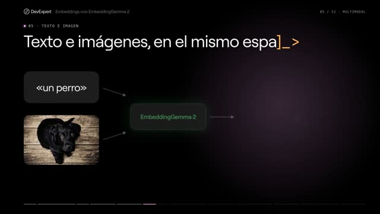

[← 返回图库](../browse/education.md) · [English](2107833536669532671.en.md)

# 用动画解释嵌入向量

**[Antonio Leiva · @antonioleivag](https://x.com/antonioleivag)** · 知识讲解 · 42s

> 发现池 · 来源已核对，编目资料待完善。

**[▶ 打开画廊播放](https://guanmo-ai.github.io/awesome-ai-motion/#case-2107833536669532671)** · [作者原帖](https://x.com/antonioleivag/status/2107833536669532671)

点击封面打开画廊播放。

搜索卡片、连线和文字图解逐步介绍嵌入向量。作者说明用 Opus 5.5 和自建幻灯片引擎制作，图像仅作为小幅示例素材；未取得引擎源码。

未取得作者公开提示词。 [查看作者原帖](https://x.com/antonioleivag/status/2107833536669532671)

收藏 468 · 点赞 263 · 浏览 21,370

## 来源记录

- 作品原帖: [@antonioleivag](https://x.com/antonioleivag/status/2107833536669532671) · 2026-10-07T14:00:51+00:00
- 模型归因: Opus 5.5 / 自建幻灯片引擎 · [作者说明](https://x.com/antonioleivag/status/2107833536669532671)
- 提示词查阅记录: [作者原帖](https://x.com/antonioleivag/status/2107833536669532671) · 2026-10-13 07:14 UTC
- 封面来源: [原帖封面来源](https://x.com/antonioleivag/status/2107833536669532671) · 21.1s
- 互动快照: [X 原帖](https://x.com/antonioleivag/status/2107833536669532671) · 2026-10-13 07:14 UTC
- 画廊原视频: [原帖媒体记录](https://x.com/antonioleivag/status/2107833536669532671) · 2026-10-13 07:14 UTC · 已核对原帖媒体对应与媒体响应；外部引用，不重新上传

模型依据来自作者自述，未独立重跑提示词，也未对音画作统一质量评级。视频引用作者原帖媒体，未由本站重新上传，转载许可未确认。
