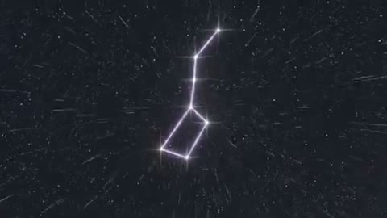

[← Back to gallery](../browse/characters.en.md) · [简体中文](2108157505993859109.md)

# A Big Dipper Beam Sequence in Minecraft

**[Otto · @ottollm](https://x.com/ottollm)** · Pixel art & characters · 31s

> Discovery pool · Source verified; catalog details being completed.

**[▶ Open gallery to play](https://guanmo-ai.github.io/awesome-ai-motion/?lang=en#case-2108157505993859109)** · [Original post](https://x.com/ottollm/status/2108157505993859109)

Click the cover to open the gallery and play.

Constellation lines, cosmic camera moves and ground impacts form a Minecraft mod sequence.

No public prompt has been verified. [View the original post](https://x.com/ottollm/status/2108157505993859109)

Bookmarks 4 · Likes 7 · Views 249

## Source record

- Original post: [@ottollm](https://x.com/ottollm/status/2108157505993859109) · 2026-10-08T11:28:11+00:00
- Model attribution: Opus 5.5 · [Creator’s statement](https://x.com/ottollm/status/2108157505993859109)
- Prompt lookup: [Creator post](https://x.com/ottollm/status/2108157505993859109) · 2026-10-19 09:24 UTC
- Cover source: [Original cover source](https://x.com/ottollm/status/2108157505993859109) · 6.21s
- Metrics snapshot: [Original X post](https://x.com/ottollm/status/2108157505993859109) · 2026-10-19 09:24 UTC
- Gallery video source: [Original post media record](https://x.com/ottollm/status/2108157505993859109) · 2026-10-19 09:24 UTC · Post/media correspondence and media response checked; external reference, no re-upload

Model attribution is based on creator statements. Prompts have not been independently rerun; sound and visuals have not received a uniform quality rating. Videos reference original post media, not our uploads; redistribution permission has not been verified.
