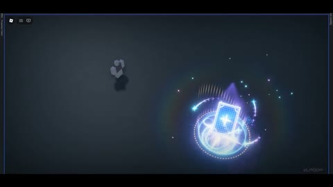

[← Back to gallery](../browse/characters.en.md) · [简体中文](2108210439813529910.md)

# A Roblox Character's Energy Ring and Burst

**[Vlp · @VlprioN](https://x.com/VlprioN)** · Pixel art & characters · 28s

> Discovery pool · Source verified; catalog details being completed.

**[▶ Open gallery to play](https://guanmo-ai.github.io/awesome-ai-motion/?lang=en#case-2108210439813529910)** · [Original post](https://x.com/VlprioN/status/2108210439813529910)

Click the cover to open the gallery and play.

Rings, trails and particles gather and burst around a character before returning to idle, demonstrating a real-time effect generated from one prompt.

No public prompt has been verified. [View the original post](https://x.com/VlprioN/status/2108210439813529910)

Bookmarks — · Likes — · Views —

## Source record

- Original post: [@VlprioN](https://x.com/VlprioN/status/2108210439813529910) · 2026-10-08T14:58:32+00:00
- Model attribution: Claude Opus 5.5 · [Creator’s statement](https://x.com/VlprioN/status/2108210439813529910)
- Prompt lookup: [Creator post](https://x.com/VlprioN/status/2108210439813529910) · 2026-11-02 08:50 UTC
- Cover source: [Original cover source](https://x.com/VlprioN/status/2108210439813529910) · 5.63s
- Metrics snapshot: [Original X post](https://x.com/VlprioN/status/2108210439813529910) · 2026-11-02 08:47 UTC
- Gallery video source: [Original post media record](https://x.com/VlprioN/status/2108210439813529910) · 2026-11-02 08:50 UTC · Post/media correspondence and media response checked; external reference, no re-upload

Model attribution is based on creator statements. Prompts have not been independently rerun; sound and visuals have not received a uniform quality rating. Videos reference original post media, not our uploads; redistribution permission has not been verified.
