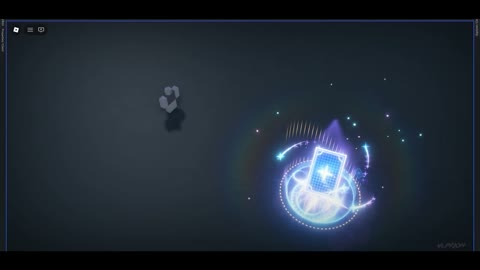

[← 返回图库](../browse/characters.md) · [English](2108210439813529910.en.md)

# Roblox 角色的能量环与爆发特效

**[Vlp · @VlprioN](https://x.com/VlprioN)** · 角色动画 · 28s

> 发现池 · 来源已核对，编目资料待完善。

**[▶ 打开画廊播放](https://guanmo-ai.github.io/awesome-ai-motion/#case-2108210439813529910)** · [作者原帖](https://x.com/VlprioN/status/2108210439813529910)

点击封面打开画廊播放。

角色周围的光环、拖尾与粒子快速聚集爆发，再恢复到待机状态，展示单条指令生成的实时特效。

未取得作者公开提示词。 [查看作者原帖](https://x.com/VlprioN/status/2108210439813529910)

收藏 — · 点赞 — · 浏览 —

## 来源记录

- 作品原帖: [@VlprioN](https://x.com/VlprioN/status/2108210439813529910) · 2026-10-08T14:58:32+00:00
- 模型归因: Claude Opus 5.5 · [作者说明](https://x.com/VlprioN/status/2108210439813529910)
- 提示词查阅记录: [作者原帖](https://x.com/VlprioN/status/2108210439813529910) · 2026-11-02 08:50 UTC
- 封面来源: [原帖封面来源](https://x.com/VlprioN/status/2108210439813529910) · 5.63s
- 互动快照: [X 原帖](https://x.com/VlprioN/status/2108210439813529910) · 2026-11-02 08:47 UTC
- 画廊原视频: [原帖媒体记录](https://x.com/VlprioN/status/2108210439813529910) · 2026-11-02 08:50 UTC · 已核对原帖媒体对应与媒体响应；外部引用，不重新上传

模型依据来自作者自述，未独立重跑提示词，也未对音画作统一质量评级。视频引用作者原帖媒体，未由本站重新上传，转载许可未确认。
