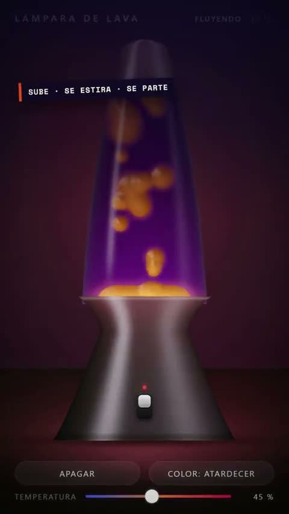

[← Back to gallery](../browse/interactive.en.md) · [简体中文](2108301452384870600.md)

# A Lava Lamp in One HTML File

**[juan carlos mercedes · @juancarlos17626](https://x.com/juancarlos17626)** · 3D & interactive · 51s

> Discovery pool · Source verified; catalog details being completed.

**[▶ Open gallery to play](https://guanmo-ai.github.io/awesome-ai-motion/?lang=en#case-2108301452384870600)** · [Original post](https://x.com/juancarlos17626/status/2108301452384870600)

Click the cover to open the gallery and play.

Glowing blobs rise and deform inside a transparent lamp against a dark background.

The creator has shared instructions; this catalog links to the source without redistributing the full text or translation. [Read the creator’s original](https://x.com/juancarlos17626/status/2108301453907382690)

Bookmarks 0 · Likes 0 · Views 61

## Source record

- Original post: [@juancarlos17626](https://x.com/juancarlos17626/status/2108301452384870600) · 2026-10-08T21:00:11+00:00
- Model attribution: Claude Opus 5.5 · [Creator’s statement](https://x.com/juancarlos17626/status/2108301452384870600)
- Prompt source: [Creator post](https://x.com/juancarlos17626/status/2108301453907382690) · 2026-10-24 12:20 UTC
- Cover source: [Original cover source](https://x.com/juancarlos17626/status/2108301452384870600) · 35.78s
- Metrics snapshot: [Original X post](https://x.com/juancarlos17626/status/2108301452384870600) · 2026-10-24 12:20 UTC
- Gallery video source: [Original post media record](https://x.com/juancarlos17626/status/2108301452384870600) · 2026-10-24 12:20 UTC · Post/media correspondence and media response checked; external reference, no re-upload

Model attribution is based on creator statements. Prompts have not been independently rerun; sound and visuals have not received a uniform quality rating. Videos reference original post media, not our uploads; redistribution permission has not been verified.
