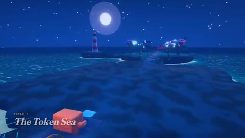

[← Back to gallery](../browse/interactive.en.md) · [简体中文](2108320373397770624.md)

# Clawd RPG: The Token Sea and Neon Stages

**[Leon Lin · @LexnLin](https://x.com/LexnLin)** · 3D & interactive · 59s

> Discovery pool · Source verified; catalog details being completed.

**[▶ Open gallery to play](https://guanmo-ai.github.io/awesome-ai-motion/?lang=en#case-2108320373397770624)** · [Original post](https://x.com/LexnLin/status/2108320373397770624)

Click the cover to open the gallery and play.

A cartoon Clawd crosses coastal and neon game scenes with moving cameras, particles and character actions, developed using Opus 5.5.

No public prompt has been verified. [View the original post](https://x.com/LexnLin/status/2108320373397770624)

Bookmarks 28 · Likes 55 · Views 3,421

## Source record

- Original post: [@LexnLin](https://x.com/LexnLin/status/2108320373397770624) · 2026-10-08T22:15:22+00:00
- Model attribution: Claude Opus 5.5 · [Creator’s statement](https://x.com/LexnLin/status/2108320373397770624)
- Prompt lookup: [Creator post](https://x.com/LexnLin/status/2108320373397770624) · 2026-10-21 09:54 UTC
- Cover source: [Original cover source](https://x.com/LexnLin/status/2108320373397770624) · 11.8s
- Metrics snapshot: [Original X post](https://x.com/LexnLin/status/2108320373397770624) · 2026-10-21 09:54 UTC
- Gallery video source: [Original post media record](https://x.com/LexnLin/status/2108320373397770624) · 2026-10-21 09:54 UTC · Post/media correspondence and media response checked; external reference, no re-upload

Model attribution is based on creator statements. Prompts have not been independently rerun; sound and visuals have not received a uniform quality rating. Videos reference original post media, not our uploads; redistribution permission has not been verified.
