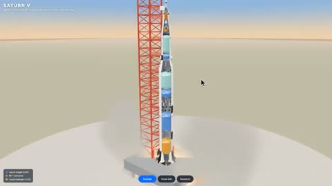

[← Back to gallery](../browse/interactive.en.md) · [简体中文](2108347412636938609.md)

# An Exploded View of Saturn V

**[AI Chris Lee \| Sell AI · @aichrislee](https://x.com/aichrislee)** · 3D & interactive · 16s

> Discovery pool · Source verified; catalog details being completed.

**[▶ Open gallery to play](https://guanmo-ai.github.io/awesome-ai-motion/?lang=en#case-2108347412636938609)** · [Original post](https://x.com/aichrislee/status/2108347412636938609)

Click the cover to open the gallery and play.

A rocket and launch tower appear in a three-dimensional scene with cutaways and layered structures exposing components.

No public prompt has been verified. [View the original post](https://x.com/aichrislee/status/2108347412636938609)

Bookmarks 0 · Likes 0 · Views 136

## Source record

- Original post: [@aichrislee](https://x.com/aichrislee/status/2108347412636938609) · 2026-10-09T00:02:49+00:00
- Model attribution: Claude Opus 5.5 · [Creator’s statement](https://x.com/aichrislee/status/2108347412636938609)
- Prompt lookup: [Creator post](https://x.com/aichrislee/status/2108347412636938609) · 2026-10-24 12:20 UTC
- Cover source: [Original cover source](https://x.com/aichrislee/status/2108347412636938609) · 3.21s
- Metrics snapshot: [Original X post](https://x.com/aichrislee/status/2108347412636938609) · 2026-10-24 12:20 UTC
- Gallery video source: [Original post media record](https://x.com/aichrislee/status/2108347412636938609) · 2026-10-24 12:20 UTC · Post/media correspondence and media response checked; external reference, no re-upload

Model attribution is based on creator statements. Prompts have not been independently rerun; sound and visuals have not received a uniform quality rating. Videos reference original post media, not our uploads; redistribution permission has not been verified.
