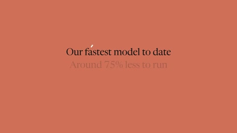

[← Back to gallery](../browse/product.en.md) · [简体中文](2108568769815818248.md)

# A Haiku 5.5 Concept Launch Animation

**[bluedev · @blueemi99](https://x.com/blueemi99)** · Product & marketing · 63s

> Discovery pool · Source verified; catalog details being completed.

**[▶ Open gallery to play](https://guanmo-ai.github.io/awesome-ai-motion/?lang=en#case-2108568769815818248)** · [Original post](https://x.com/blueemi99/status/2108568769815818248)

Click the cover to open the gallery and play.

Titles, charts and brand colors form a model-themed concept promo; performance figures are not independently verified.

No public prompt has been verified. [View the original post](https://x.com/blueemi99/status/2108568769815818248)

Bookmarks — · Likes — · Views —

## Source record

- Original post: [@blueemi99](https://x.com/blueemi99/status/2108568769815818248) · 2026-10-09T14:42:24+00:00
- Model attribution: Claude Opus 5.5 · [Creator’s statement](https://x.com/blueemi99/status/2108568769815818248)
- Prompt lookup: [Creator post](https://x.com/blueemi99/status/2108568769815818248) · 2026-11-02 15:38 UTC
- Cover source: [Original cover source](https://x.com/blueemi99/status/2108568769815818248) · 12.62s
- Metrics snapshot: [Original X post](https://x.com/blueemi99/status/2108568769815818248) · 2026-11-02 15:05 UTC
- Gallery video source: [Original post media record](https://x.com/blueemi99/status/2108568769815818248) · 2026-11-02 15:38 UTC · Post/media correspondence and media response checked; external reference, no re-upload

Model attribution is based on creator statements. Prompts have not been independently rerun; sound and visuals have not received a uniform quality rating. Videos reference original post media, not our uploads; redistribution permission has not been verified.
