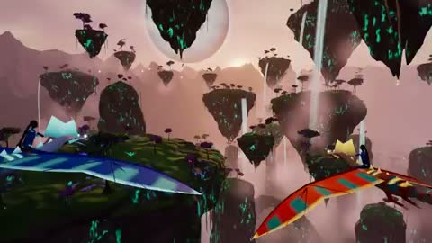

[← Back to gallery](../browse/interactive.en.md) · [简体中文](2108588869255827570.md)

# Flying through Floating Mountains

**[Rhino · @0xRhinoX](https://x.com/0xRhinoX)** · 3D & interactive · 30s

> Discovery pool · Source verified; catalog details being completed.

**[▶ Open gallery to play](https://guanmo-ai.github.io/awesome-ai-motion/?lang=en#case-2108588869255827570)** · [Original post](https://x.com/0xRhinoX/status/2108588869255827570)

Click the cover to open the gallery and play.

[Creator’s interactive work](https://aeloria.pokeable.app/)

Floating mountains, stylized flying creatures and rings form a procedural world that the creator says is generated from a seed with Three.js.

## Source & web pages

- **Public web page**：[Creator’s interactive work](https://aeloria.pokeable.app/)
  Linked by the creator; full interaction and availability were not verified in this pass.
  [Link source](https://x.com/0xRhinoX/status/2108588869255827570) · Link checked 2026-10-19 09:12 UTC

No public prompt has been verified. [View the original post](https://x.com/0xRhinoX/status/2108588869255827570)

Bookmarks 44 · Likes 63 · Views 3,722

## Source record

- Original post: [@0xRhinoX](https://x.com/0xRhinoX/status/2108588869255827570) · 2026-10-09T16:02:16+00:00
- Model attribution: Opus 5.5 · [Creator’s statement](https://x.com/0xRhinoX/status/2108588869255827570)
- Prompt lookup: [Creator post](https://x.com/0xRhinoX/status/2108588869255827570) · 2026-10-19 09:12 UTC
- Cover source: [Original cover source](https://x.com/0xRhinoX/status/2108588869255827570) · 6s
- Metrics snapshot: [Original X post](https://x.com/0xRhinoX/status/2108588869255827570) · 2026-10-19 09:12 UTC
- Gallery video source: [Original post media record](https://x.com/0xRhinoX/status/2108588869255827570) · 2026-10-19 09:12 UTC · Post/media correspondence and media response checked; external reference, no re-upload

Model attribution is based on creator statements. Prompts have not been independently rerun; sound and visuals have not received a uniform quality rating. Videos reference original post media, not our uploads; redistribution permission has not been verified.
