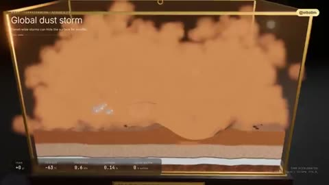

[← Back to gallery](../browse/education.en.md) · [简体中文](2108976029180059757.md)

# A Staged Mars-Terraforming Simulation

**[Otto · @ottollm](https://x.com/ottollm)** · Education & explainers · 60s

> Discovery pool · Source verified; catalog details being completed.

**[▶ Open gallery to play](https://guanmo-ai.github.io/awesome-ai-motion/?lang=en#case-2108976029180059757)** · [Original post](https://x.com/ottollm/status/2108976029180059757)

Click the cover to open the gallery and play.

Dust, terrain, water and vegetation change over time; stages and figures belong to the creator’s scenario.

No public prompt has been verified. [View the original post](https://x.com/ottollm/status/2108976029180059757)

Bookmarks 4 · Likes 8 · Views 586

## Source record

- Original post: [@ottollm](https://x.com/ottollm/status/2108976029180059757) · 2026-10-10T17:40:42+00:00
- Model attribution: Opus 5.5 · [Creator’s statement](https://x.com/ottollm/status/2108976029180059757)
- Prompt lookup: [Creator post](https://x.com/ottollm/status/2108976029180059757) · 2026-10-19 08:47 UTC
- Cover source: [Original cover source](https://x.com/ottollm/status/2108976029180059757) · 12.01s
- Metrics snapshot: [Original X post](https://x.com/ottollm/status/2108976029180059757) · 2026-10-19 08:47 UTC
- Gallery video source: [Original post media record](https://x.com/ottollm/status/2108976029180059757) · 2026-10-19 08:47 UTC · Post/media correspondence and media response checked; external reference, no re-upload

Model attribution is based on creator statements. Prompts have not been independently rerun; sound and visuals have not received a uniform quality rating. Videos reference original post media, not our uploads; redistribution permission has not been verified.
