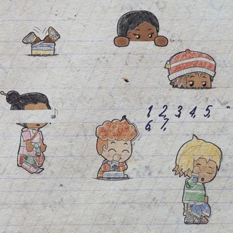

[← Back to gallery](../browse/motion.en.md) · [简体中文](2109003656280646014.md)

# Paper Doodle Animation Loops

**[Kevin Ngo · @kevin\_t\_ngo](https://x.com/kevin_t_ngo)** · Motion design · 5s

> Discovery pool · Source verified; catalog details being completed.

**[▶ Open gallery to play](https://guanmo-ai.github.io/awesome-ai-motion/?lang=en#case-2109003656280646014)** · [Original post](https://x.com/kevin_t_ngo/status/2109003656280646014)

Click the cover to open the gallery and play.

Cartoon doodles flip, peek and sway on paper. The creator credits Opus 5.5 and JavaScript. The original post contains four loops; the gallery plays one.

No public prompt has been verified. [View the original post](https://x.com/kevin_t_ngo/status/2109003656280646014)

Bookmarks 259 · Likes 415 · Views 14,973

## Source record

- Original post: [@kevin\_t\_ngo](https://x.com/kevin_t_ngo/status/2109003656280646014) · 2026-10-10T19:30:29+00:00
- Model attribution: Opus 5.5 · [Creator’s statement](https://x.com/kevin_t_ngo/status/2109003656280646014)
- Prompt lookup: [Creator post](https://x.com/kevin_t_ngo/status/2109003656280646014) · 2026-10-14 04:45 UTC
- Cover source: [Original cover source](https://x.com/kevin_t_ngo/status/2109003656280646014) · 2.2s
- Metrics snapshot: [Original X post](https://x.com/kevin_t_ngo/status/2109003656280646014) · 2026-10-14 04:45 UTC
- Gallery video source: [Original post media record](https://x.com/kevin_t_ngo/status/2109003656280646014) · 2026-10-14 04:45 UTC · Post/media correspondence and media response checked; external reference, no re-upload

Model attribution is based on creator statements. Prompts have not been independently rerun; sound and visuals have not received a uniform quality rating. Videos reference original post media, not our uploads; redistribution permission has not been verified.

The post contains 4 videos; this cover shows the first.
