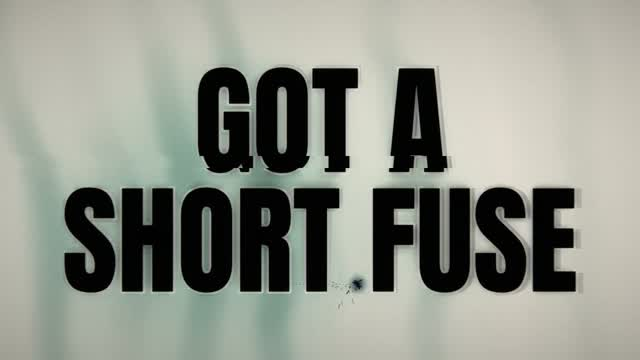

[← Back to gallery](../browse/music.en.md) · [简体中文](2109087249572749553.md)

# Turn It Up Now: A Kinetic Lyric Video

**[klöss · @kloss\_xyz](https://x.com/kloss_xyz)** · Music & lyrics · 110s

> Discovery pool · Source verified; catalog details being completed.

**[▶ Open gallery to play](https://guanmo-ai.github.io/awesome-ai-motion/?lang=en#case-2109087249572749553)** · [Original post](https://x.com/kloss_xyz/status/2109087249572749553)

Click the cover to open the gallery and play.

Kinetic typography, waveforms and changing backgrounds present the lyrics. The creator describes HTML visuals written with Opus 5.5 and exported in the browser, using a Suno song, and shares the prompt.

The creator has shared instructions; this catalog links to the source without redistributing the full text or translation. [Read the creator’s original](https://x.com/kloss_xyz/status/2109087249572749553)

Bookmarks 34 · Likes 60 · Views 4,935

## Source record

- Original post: [@kloss\_xyz](https://x.com/kloss_xyz/status/2109087249572749553) · 2026-10-11T01:02:39+00:00
- Model attribution: Opus 5.5 / HTML / Suno · [Creator’s statement](https://x.com/kloss_xyz/status/2109087249572749553)
- Prompt source: [Creator post](https://x.com/kloss_xyz/status/2109087249572749553) · 2026-10-13 07:14 UTC
- Cover source: [Original cover source](https://x.com/kloss_xyz/status/2109087249572749553) · 55.15s
- Metrics snapshot: [Original X post](https://x.com/kloss_xyz/status/2109087249572749553) · 2026-10-13 07:14 UTC
- Gallery video source: [Original post media record](https://x.com/kloss_xyz/status/2109087249572749553) · 2026-10-13 07:14 UTC · Post/media correspondence and media response checked; external reference, no re-upload

Model attribution is based on creator statements. Prompts have not been independently rerun; sound and visuals have not received a uniform quality rating. Videos reference original post media, not our uploads; redistribution permission has not been verified.
