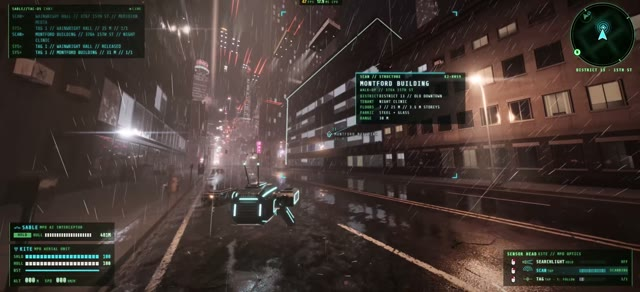

[← 返回图库](../browse/interactive.md) · [English](2109107708192284923.en.md)

# DYSTOPIA：雨夜浏览器城市

**[cryptomanavan ☀️ · @cryptomanavan](https://x.com/cryptomanavan)** · 交互演示 · 84s

> 发现池 · 来源已核对，编目资料待完善。

**[▶ 打开画廊播放](https://guanmo-ai.github.io/awesome-ai-motion/#case-2109107708192284923)** · [作者原帖](https://x.com/cryptomanavan/status/2109107708192284923)

点击封面打开画廊播放。

[DYSTOPIA 浏览器城市](https://dystopia-noir.netlify.app/)

作者发布仍在开发中的 DYSTOPIA，提供驾驶、飞行与无人机探索的浏览器城市，并说明使用 Three.js、WebGPU、Rapier 和 Claude Opus 5.5。作者提供公开演示，运行需要 WebGPU；未完成完整试玩。

## 源码与网页

- **公开网页**：[DYSTOPIA 浏览器城市](https://dystopia-noir.netlify.app/)
  作者提供的公开网页；需要 WebGPU，作品仍在开发中，未完成完整试玩。
  [链接出处](https://x.com/cryptomanavan/status/2109107708192284923) · 链接核对 2026-10-11 15:09 UTC

未取得作者公开提示词。 [查看作者原帖](https://x.com/cryptomanavan/status/2109107708192284923)

收藏 14 · 点赞 29 · 浏览 1,234

## 来源记录

- 作品原帖: [@cryptomanavan](https://x.com/cryptomanavan/status/2109107708192284923) · 2026-10-11T02:23:57+00:00
- 模型归因: Claude Opus 5.5 / Three.js / WebGPU / Rapier · [作者说明](https://x.com/cryptomanavan/status/2109107708192284923)
- 提示词查阅记录: [作者原帖](https://x.com/cryptomanavan/status/2109107708192284923) · 2026-10-11 12:13 UTC
- 封面来源: [原帖封面来源](https://x.com/cryptomanavan/status/2109107708192284923) · 5s
- 互动快照: [X 原帖](https://x.com/cryptomanavan/status/2109107708192284923) · 2026-10-11 12:13 UTC
- 画廊原视频: [原帖媒体记录](https://x.com/cryptomanavan/status/2109107708192284923) · 2026-10-11 12:14 UTC · 已核对原帖媒体对应与媒体响应；外部引用，不重新上传

模型依据来自作者自述，未独立重跑提示词，也未对音画作统一质量评级。视频引用作者原帖媒体，未由本站重新上传，转载许可未确认。
