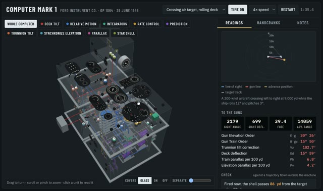

[← 返回图库](../browse/interactive.md) · [English](2109173369140810135.en.md)

# Computer Mark I 模拟计算机演示

**[C · @markovs\_razor](https://x.com/markovs_razor)** · 交互演示 · 60s

> 发现池 · 来源已核对，编目资料待完善。

**[▶ 打开画廊播放](https://guanmo-ai.github.io/awesome-ai-motion/#case-2109173369140810135)** · [作者原帖](https://x.com/markovs_razor/status/2109173369140810135)

点击封面打开画廊播放。

作者展示二战时期 Computer Mark I 火控模拟计算机，说明使用 Opus 5.5，以一份约三百页的 1945 年海军手册为输入制作。原帖没有公开完整指令；计算和历史准确性未独立核验。

作者任务描述 · 非完整提示词。完整指令尚未取得，请查看作者原帖。 [查看作者原帖](https://x.com/markovs_razor/status/2109173369140810135)

收藏 0 · 点赞 6 · 浏览 257

## 来源记录

- 作品原帖: [@markovs\_razor](https://x.com/markovs_razor/status/2109173369140810135) · 2026-10-11T06:44:52+00:00
- 模型归因: Opus 5.5 · [作者说明](https://x.com/markovs_razor/status/2109173369140810135)
- 提示词出处: [作者原帖](https://x.com/markovs_razor/status/2109173369140810135) · 2026-10-11 12:13 UTC
- 封面来源: [原帖封面来源](https://x.com/markovs_razor/status/2109173369140810135) · 3s
- 互动快照: [X 原帖](https://x.com/markovs_razor/status/2109173369140810135) · 2026-10-11 12:13 UTC
- 画廊原视频: [原帖媒体记录](https://x.com/markovs_razor/status/2109173369140810135) · 2026-10-11 12:14 UTC · 已核对原帖媒体对应与媒体响应；外部引用，不重新上传

模型依据来自作者自述，未独立重跑提示词，也未对音画作统一质量评级。视频引用作者原帖媒体，未由本站重新上传，转载许可未确认。
