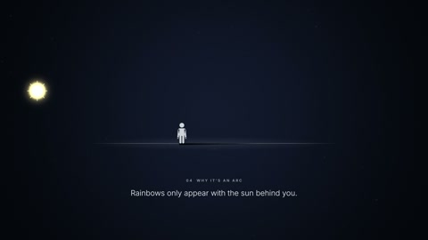

[← 返回图库](../browse/education.md) · [English](2109201684622913822.en.md)

# 光线与棱镜的科普动效

**[Kryptoknight · @\_goaltracker\_](https://x.com/_goaltracker_)** · 知识讲解 · 120s

> 发现池 · 来源已核对，编目资料待完善。

**[▶ 打开画廊播放](https://guanmo-ai.github.io/awesome-ai-motion/#case-2109201684622913822)** · [作者原帖](https://x.com/_goaltracker_/status/2109201684622913822)

点击封面打开画廊播放。

棱镜、光线和光谱组成科普讲解。作者明确称 Opus 5.5 Medium 一次生成；未公开具体工程。

未取得作者公开提示词。 [查看作者原帖](https://x.com/_goaltracker_/status/2109201684622913822)

收藏 0 · 点赞 0 · 浏览 29

## 来源记录

- 作品原帖: [@\_goaltracker\_](https://x.com/_goaltracker_/status/2109201684622913822) · 2026-10-11T08:37:23+00:00
- 模型归因: Opus 5.5 · [作者说明](https://x.com/_goaltracker_/status/2109201684622913822)
- 提示词查阅记录: [作者原帖](https://x.com/_goaltracker_/status/2109201684622913822) · 2026-10-13 06:06 UTC
- 封面来源: [原帖封面来源](https://x.com/_goaltracker_/status/2109201684622913822) · 60s
- 互动快照: [X 原帖](https://x.com/_goaltracker_/status/2109201684622913822) · 2026-10-13 06:06 UTC
- 画廊原视频: [原帖媒体记录](https://x.com/_goaltracker_/status/2109201684622913822) · 2026-10-13 06:06 UTC · 已核对原帖媒体对应与媒体响应；外部引用，不重新上传

模型依据来自作者自述，未独立重跑提示词，也未对音画作统一质量评级。视频引用作者原帖媒体，未由本站重新上传，转载许可未确认。
