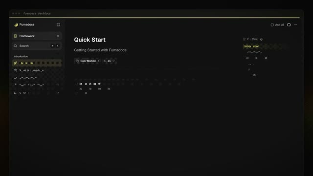

[← 返回图库](../browse/product.md) · [English](2109204810818064634.en.md)

# Fumadocs 文档产品动效

**[Fuma Nama · @fuma\_nama](https://x.com/fuma_nama)** · 产品宣传 · 63s

> 发现池 · 来源已核对，编目资料待完善。

**[▶ 打开画廊播放](https://guanmo-ai.github.io/awesome-ai-motion/#case-2109204810818064634)** · [作者原帖](https://x.com/fuma_nama/status/2109204810818064634)

点击封面打开画廊播放。

作者为 Fumadocs 发布约一分钟的产品展示，并说明动画由 Opus 制作。原帖未说明模型版本，没有公开完整制作指令或该视频工程。

未取得作者公开提示词。 [查看作者原帖](https://x.com/fuma_nama/status/2109204810818064634)

收藏 8 · 点赞 53 · 浏览 1,301

## 来源记录

- 作品原帖: [@fuma\_nama](https://x.com/fuma_nama/status/2109204810818064634) · 2026-10-11T08:49:48+00:00
- 模型归因: Opus · [作者说明](https://x.com/fuma_nama/status/2109204810818064634)
- 提示词查阅记录: [作者原帖](https://x.com/fuma_nama/status/2109204810818064634) · 2026-10-11 12:13 UTC
- 封面来源: [原帖封面来源](https://x.com/fuma_nama/status/2109204810818064634) · 4s
- 互动快照: [X 原帖](https://x.com/fuma_nama/status/2109204810818064634) · 2026-10-11 12:13 UTC
- 画廊原视频: [原帖媒体记录](https://x.com/fuma_nama/status/2109204810818064634) · 2026-10-11 12:14 UTC · 已核对原帖媒体对应与媒体响应；外部引用，不重新上传

模型依据来自作者自述，未独立重跑提示词，也未对音画作统一质量评级。视频引用作者原帖媒体，未由本站重新上传，转载许可未确认。
