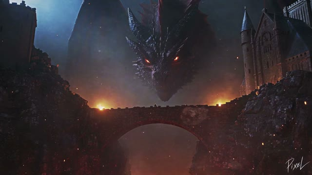

[← Back to gallery](../browse/stories.en.md) · [简体中文](2109219890133360941.md)

# Sir Duke and Dame Pawline

**[PIXEL · @itsPixieVerse](https://x.com/itsPixieVerse)** · Narrative films · 30s

> Discovery pool · Source verified; catalog details being completed.

**[▶ Open gallery to play](https://guanmo-ai.github.io/awesome-ai-motion/?lang=en#case-2109219890133360941)** · [Original post](https://x.com/itsPixieVerse/status/2109219890133360941)

Click the cover to open the gallery and play.

The creator introduces their pet Duke as a tiny knight alongside the popular kitty-knight theme in Sir Duke & Dame Pawline: The Dragon Slayers, crediting Seedance 2.5. No complete prompt is shared.

No public prompt has been verified. [View the original post](https://x.com/itsPixieVerse/status/2109219890133360941)

Bookmarks 2 · Likes 8 · Views 337

## Source record

- Original post: [@itsPixieVerse](https://x.com/itsPixieVerse/status/2109219890133360941) · 2026-10-11T09:49:43+00:00
- Model attribution: Seedance 2.5 · [Creator’s statement](https://x.com/itsPixieVerse/status/2109219890133360941)
- Prompt lookup: [Creator post](https://x.com/itsPixieVerse/status/2109219890133360941) · 2026-10-11 12:14 UTC
- Cover source: [Original cover source](https://x.com/itsPixieVerse/status/2109219890133360941) · 3s
- Metrics snapshot: [Original X post](https://x.com/itsPixieVerse/status/2109219890133360941) · 2026-10-11 12:14 UTC
- Gallery video source: [Original post media record](https://x.com/itsPixieVerse/status/2109219890133360941) · 2026-10-11 12:14 UTC · Post/media correspondence and media response checked; external reference, no re-upload

Model attribution is based on creator statements. Prompts have not been independently rerun; sound and visuals have not received a uniform quality rating. Videos reference original post media, not our uploads; redistribution permission has not been verified.
