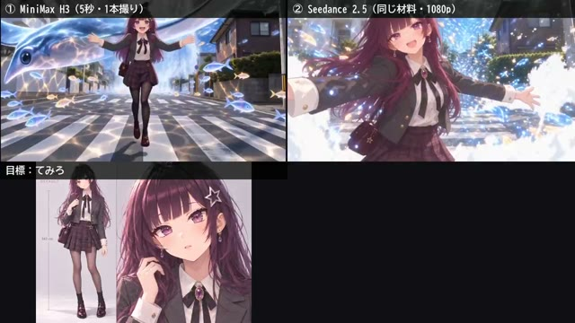

[← Back to gallery](../browse/characters.en.md) · [简体中文](2109240092015419613.md)

# A Continuous-Shot Comparison from the Same Storyboard

**[てみろ -temiro-｜AI歌い手の制作現場 · @temiro\_ai](https://x.com/temiro_ai)** · Pixel art & characters · 16s

> Discovery pool · Source verified; catalog details being completed.

**[▶ Open gallery to play](https://guanmo-ai.github.io/awesome-ai-motion/?lang=en#case-2109240092015419613)** · [Original post](https://x.com/temiro_ai/status/2109240092015419613)

Click the cover to open the gallery and play.

The creator compares MiniMax H3 and Seedance 2.5 using the same character sheet and storyboard for an animated character in a live-action city. The post discusses continuity and texture in a five-second shot. This is one comparison experiment without a complete generation prompt.

Author brief · not the complete prompt. The complete instructions have not been verified; see the creator’s post. [View the original post](https://x.com/temiro_ai/status/2109240092015419613)

Bookmarks 0 · Likes 0 · Views 22

## Source record

- Original post: [@temiro\_ai](https://x.com/temiro_ai/status/2109240092015419613) · 2026-10-11T11:10:00+00:00
- Model attribution: MiniMax H3 / Seedance 2.5 · [Creator’s statement](https://x.com/temiro_ai/status/2109240092015419613)
- Prompt source: [Creator post](https://x.com/temiro_ai/status/2109240092015419613) · 2026-10-11 12:14 UTC
- Cover source: [Original cover source](https://x.com/temiro_ai/status/2109240092015419613) · 3s
- Metrics snapshot: [Original X post](https://x.com/temiro_ai/status/2109240092015419613) · 2026-10-11 12:14 UTC
- Gallery video source: [Original post media record](https://x.com/temiro_ai/status/2109240092015419613) · 2026-10-11 12:14 UTC · Post/media correspondence and media response checked; external reference, no re-upload

Model attribution is based on creator statements. Prompts have not been independently rerun; sound and visuals have not received a uniform quality rating. Videos reference original post media, not our uploads; redistribution permission has not been verified.
