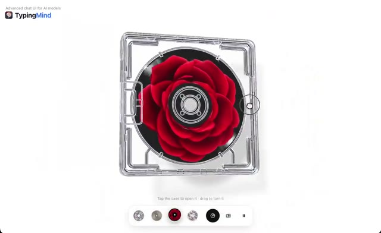

[← 返回图库](../browse/interactive.md) · [English](2109257723246501895.en.md)

# 透明 CD 盒的材质与开盖交互

**[Ann Nguyen · @ann\_nnng](https://x.com/ann_nnng)** · 交互演示 · 30s

> 发现池 · 来源已核对，编目资料待完善。

**[▶ 打开画廊播放](https://guanmo-ai.github.io/awesome-ai-motion/#case-2109257723246501895)** · [作者原帖](https://x.com/ann_nnng/status/2109257723246501895)

点击封面打开画廊播放。

作者用 Claude Opus 5.5、Three.js 与着色器制作透明 CD 盒，可切换光盘图案并打开盒盖。作者明确说明未使用 3D 模型；原帖提供交互录屏，没有公开完整工程。

作者任务描述 · 非完整提示词。完整指令尚未取得，请查看作者原帖。 [查看作者原帖](https://x.com/ann_nnng/status/2109257723246501895)

收藏 3,816 · 点赞 5,968 · 浏览 232,114

## 来源记录

- 作品原帖: [@ann\_nnng](https://x.com/ann_nnng/status/2109257723246501895) · 2026-10-11T12:20:03+00:00
- 模型归因: Claude Opus 5.5 / Three.js · [作者说明](https://x.com/ann_nnng/status/2109257723246501895)
- 提示词出处: [作者原帖](https://x.com/ann_nnng/status/2109257723246501895) · 2026-10-13 05:46 UTC
- 封面来源: [原帖封面来源](https://x.com/ann_nnng/status/2109257723246501895) · 14.92s
- 互动快照: [X 原帖](https://x.com/ann_nnng/status/2109257723246501895) · 2026-10-13 05:46 UTC
- 画廊原视频: [原帖媒体记录](https://x.com/ann_nnng/status/2109257723246501895) · 2026-10-13 05:48 UTC · 已核对原帖媒体对应与媒体响应；外部引用，不重新上传

模型依据来自作者自述，未独立重跑提示词，也未对音画作统一质量评级。视频引用作者原帖媒体，未由本站重新上传，转载许可未确认。
