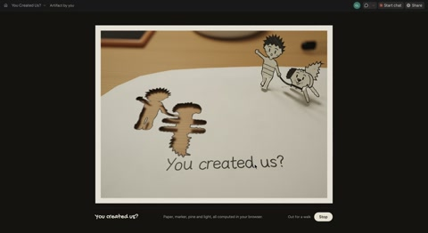

[← Back to gallery](../browse/stories.en.md) · [简体中文](2109290983896818132.md)

# Paper Doodle Characters Stand Up

**[Chetaslua · @chetaslua](https://x.com/chetaslua)** · Narrative films · 22s

> Discovery pool · Source verified; catalog details being completed.

**[▶ Open gallery to play](https://guanmo-ai.github.io/awesome-ai-motion/?lang=en#case-2109290983896818132)** · [Original post](https://x.com/chetaslua/status/2109290983896818132)

Click the cover to open the gallery and play.

Doodle characters rise from paper and move through a tabletop setting. The creator states that the visuals are fully coded; the specific model version is unverified and the film source has not been obtained.

No public prompt has been verified. [View the original post](https://x.com/chetaslua/status/2109290983896818132)

Bookmarks 784 · Likes 1,634 · Views 481,651

## Source record

- Original post: [@chetaslua](https://x.com/chetaslua/status/2109290983896818132) · 2026-10-11T14:32:13+00:00
- Model attribution: Claude Code / 具体模型版本未确认 · [Creator’s statement](https://x.com/chetaslua/status/2109290983896818132)
- Prompt lookup: [Creator post](https://x.com/chetaslua/status/2109290983896818132) · 2026-10-13 06:28 UTC
- Cover source: [Original cover source](https://x.com/chetaslua/status/2109290983896818132) · 10.97s
- Metrics snapshot: [Original X post](https://x.com/chetaslua/status/2109290983896818132) · 2026-10-13 06:28 UTC
- Gallery video source: [Original post media record](https://x.com/chetaslua/status/2109290983896818132) · 2026-10-13 06:28 UTC · Post/media correspondence and media response checked; external reference, no re-upload

Model attribution is based on creator statements. Prompts have not been independently rerun; sound and visuals have not received a uniform quality rating. Videos reference original post media, not our uploads; redistribution permission has not been verified.
