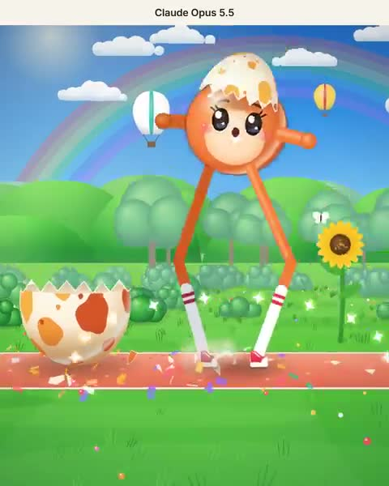

[← 返回图库](../browse/characters.md) · [English](2109297316242812936.en.md)

# Gregg：从蛋中诞生的吉祥物

**[West Lord · @MyWestLord](https://x.com/MyWestLord)** · 角色动画 · 19s

> 发现池 · 来源已核对，编目资料待完善。

**[▶ 打开画廊播放](https://guanmo-ai.github.io/awesome-ai-motion/#case-2109297316242812936)** · [作者原帖](https://x.com/MyWestLord/status/2109297316242812936)

点击封面打开画廊播放。

卡通吉祥物从蛋中诞生，脚步和动作由自写渲染器绘制。

未取得作者公开提示词。 [查看作者原帖](https://x.com/MyWestLord/status/2109297316242812936)

收藏 6 · 点赞 11 · 浏览 1,348

## 来源记录

- 作品原帖: [@MyWestLord](https://x.com/MyWestLord/status/2109297316242812936) · 2026-10-11T14:57:23+00:00
- 模型归因: Opus 5.5 · [作者说明](https://x.com/MyWestLord/status/2109297316242812936)
- 提示词查阅记录: [作者原帖](https://x.com/MyWestLord/status/2109297316242812936) · 2026-10-16 07:22 UTC
- 封面来源: [原帖封面来源](https://x.com/MyWestLord/status/2109297316242812936) · 3.87s
- 互动快照: [X 原帖](https://x.com/MyWestLord/status/2109297316242812936) · 2026-10-16 07:22 UTC
- 画廊原视频: [原帖媒体记录](https://x.com/MyWestLord/status/2109297316242812936) · 2026-10-16 07:22 UTC · 已核对原帖媒体对应与媒体响应；外部引用，不重新上传

模型依据来自作者自述，未独立重跑提示词，也未对音画作统一质量评级。视频引用作者原帖媒体，未由本站重新上传，转载许可未确认。
