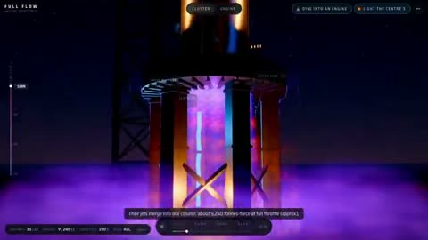

[← Back to gallery](../browse/education.en.md) · [简体中文](2109312002099441934.md)

# Raptor 3: From Engine Cluster to Internal Flow

**[Techartist · @techartist\_](https://x.com/techartist_)** · Education & explainers · 25s

> Discovery pool · Source verified; catalog details being completed.

**[▶ Open gallery to play](https://guanmo-ai.github.io/awesome-ai-motion/?lang=en#case-2109312002099441934)** · [Original post](https://x.com/techartist_/status/2109312002099441934)

Click the cover to open the gallery and play.

An engine cluster, cutaway and animated flow effects illustrate a rocket engine.

No public prompt has been verified. [View the original post](https://x.com/techartist_/status/2109312002099441934)

Bookmarks 19 · Likes 110 · Views 3,173

## Source record

- Original post: [@techartist\_](https://x.com/techartist_/status/2109312002099441934) · 2026-10-11T15:55:45+00:00
- Model attribution: Opus 5.5 · [Creator’s statement](https://x.com/techartist_/status/2109312002099441934)
- Prompt lookup: [Creator post](https://x.com/techartist_/status/2109312002099441934) · 2026-10-19 08:47 UTC
- Cover source: [Original cover source](https://x.com/techartist_/status/2109312002099441934) · 5.03s
- Metrics snapshot: [Original X post](https://x.com/techartist_/status/2109312002099441934) · 2026-10-19 08:47 UTC
- Gallery video source: [Original post media record](https://x.com/techartist_/status/2109312002099441934) · 2026-10-19 08:47 UTC · Post/media correspondence and media response checked; external reference, no re-upload

Model attribution is based on creator statements. Prompts have not been independently rerun; sound and visuals have not received a uniform quality rating. Videos reference original post media, not our uploads; redistribution permission has not been verified.
