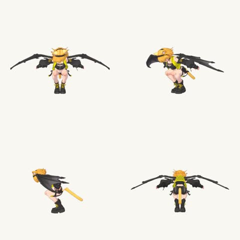

[← Back to gallery](../browse/characters.en.md) · [简体中文](2109401850655182861.md)

# A Winged Character Moving from Four Angles

**[AI Bard Guild · @IsekaiBardGuild](https://x.com/IsekaiBardGuild)** · Pixel art & characters · 16s

> Discovery pool · Source verified; catalog details being completed.

**[▶ Open gallery to play](https://guanmo-ai.github.io/awesome-ai-motion/?lang=en#case-2109401850655182861)** · [Original post](https://x.com/IsekaiBardGuild/status/2109401850655182861)

Click the cover to open the gallery and play.

A stylized winged character turns and moves in four synchronized views, showing coordinated wings, limbs and skeletal animation.

No public prompt has been verified. [View the original post](https://x.com/IsekaiBardGuild/status/2109401850655182861)

Bookmarks — · Likes 336 · Views —

## Source record

- Original post: [@IsekaiBardGuild](https://x.com/IsekaiBardGuild/status/2109401850655182861) · 2026-10-11T21:52:46+00:00
- Model attribution: Claude Opus 5.5 · [Creator’s statement](https://x.com/IsekaiBardGuild/status/2109401850655182861)
- Prompt lookup: [Creator post](https://x.com/IsekaiBardGuild/status/2109401850655182861) · 2026-10-26 15:21 UTC
- Cover source: [Original cover source](https://x.com/IsekaiBardGuild/status/2109401850655182861) · 3.12s
- Metrics snapshot: [Original X post](https://x.com/IsekaiBardGuild/status/2109401850655182861) · 2026-10-26 14:56 UTC
- Gallery video source: [Original post media record](https://x.com/IsekaiBardGuild/status/2109401850655182861) · 2026-10-26 15:21 UTC · Post/media correspondence and media response checked; external reference, no re-upload

Model attribution is based on creator statements. Prompts have not been independently rerun; sound and visuals have not received a uniform quality rating. Videos reference original post media, not our uploads; redistribution permission has not been verified.
