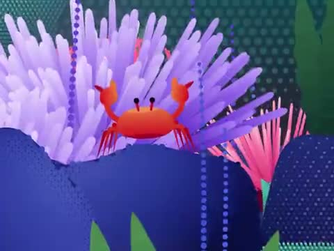

[← 返回图库](../browse/interactive.md) · [English](2109494015767007331.en.md)

# 斑点珊瑚礁的小世界

**[maggie · @untitled\_sys](https://x.com/untitled_sys)** · 交互演示 · 20s

> 发现池 · 来源已核对，编目资料待完善。

**[▶ 打开画廊播放](https://guanmo-ai.github.io/awesome-ai-motion/#case-2109494015767007331)** · [作者原帖](https://x.com/untitled_sys/status/2109494015767007331)

点击封面打开画廊播放。

彩色珊瑚、螃蟹与小鱼组成非写实三维海底场景。

未取得作者公开提示词。 [查看作者原帖](https://x.com/untitled_sys/status/2109494015767007331)

收藏 1 · 点赞 5 · 浏览 295

## 来源记录

- 作品原帖: [@untitled\_sys](https://x.com/untitled_sys/status/2109494015767007331) · 2026-10-12T03:59:00+00:00
- 模型归因: Opus 5.5 · [作者说明](https://x.com/untitled_sys/status/2109494015767007331)
- 提示词查阅记录: [作者原帖](https://x.com/untitled_sys/status/2109494015767007331) · 2026-10-16 06:39 UTC
- 封面来源: [原帖封面来源](https://x.com/untitled_sys/status/2109494015767007331) · 4s
- 互动快照: [X 原帖](https://x.com/untitled_sys/status/2109494015767007331) · 2026-10-16 06:39 UTC
- 画廊原视频: [原帖媒体记录](https://x.com/untitled_sys/status/2109494015767007331) · 2026-10-16 06:39 UTC · 已核对原帖媒体对应与媒体响应；外部引用，不重新上传

模型依据来自作者自述，未独立重跑提示词，也未对音画作统一质量评级。视频引用作者原帖媒体，未由本站重新上传，转载许可未确认。
