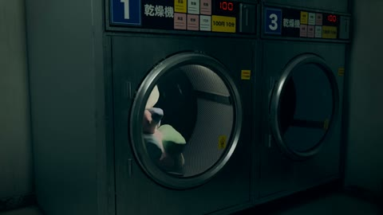

[← 返回图库](../browse/interactive.md) · [English](2109609040716452113.en.md)

# 深夜洗衣房里的卡通角色

**[みどり🐲Midori Tatsuta · @midori\_tatsuta](https://x.com/midori_tatsuta)** · 交互演示 · 10s

> 发现池 · 来源已核对，编目资料待完善。

**[▶ 打开画廊播放](https://guanmo-ai.github.io/awesome-ai-motion/#case-2109609040716452113)** · [作者原帖](https://x.com/midori_tatsuta/status/2109609040716452113)

点击封面打开画廊播放。

昏暗洗衣房中，卡通角色与转动的滚筒、玻璃和灯光共同组成带镜头运动的场景。

未取得作者公开提示词。 [查看作者原帖](https://x.com/midori_tatsuta/status/2109609040716452113)

收藏 — · 点赞 854 · 浏览 —

## 来源记录

- 作品原帖: [@midori\_tatsuta](https://x.com/midori_tatsuta/status/2109609040716452113) · 2026-10-12T11:36:04+00:00
- 模型归因: Claude Opus 5.5 · [作者说明](https://x.com/midori_tatsuta/status/2109609040716452113)
- 提示词查阅记录: [作者原帖](https://x.com/midori_tatsuta/status/2109609040716452113) · 2026-10-26 15:21 UTC
- 封面来源: [原帖封面来源](https://x.com/midori_tatsuta/status/2109609040716452113) · 2s
- 互动快照: [X 原帖](https://x.com/midori_tatsuta/status/2109609040716452113) · 2026-10-26 14:56 UTC
- 画廊原视频: [原帖媒体记录](https://x.com/midori_tatsuta/status/2109609040716452113) · 2026-10-26 15:21 UTC · 已核对原帖媒体对应与媒体响应；外部引用，不重新上传

模型依据来自作者自述，未独立重跑提示词，也未对音画作统一质量评级。视频引用作者原帖媒体，未由本站重新上传，转载许可未确认。
