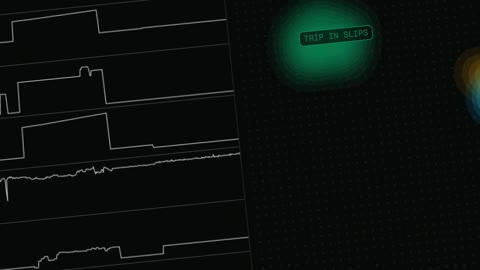

[← Back to gallery](../browse/motion.en.md) · [简体中文](2109708226925314546.md)

# From Signal to Meaning in Five Seconds

**[Lukas Moro · @lukas\_moro](https://x.com/lukas_moro)** · Motion design · 5s

> Discovery pool · Source verified; catalog details being completed.

**[▶ Open gallery to play](https://guanmo-ai.github.io/awesome-ai-motion/?lang=en#case-2109708226925314546)** · [Original post](https://x.com/lukas_moro/status/2109708226925314546)

Click the cover to open the gallery and play.

Thin signals, glowing nodes and a moving camera connect in a quick study of changing data structures.

No public prompt has been verified. [View the original post](https://x.com/lukas_moro/status/2109708226925314546)

Bookmarks — · Likes — · Views —

## Source record

- Original post: [@lukas\_moro](https://x.com/lukas_moro/status/2109708226925314546) · 2026-10-12T18:10:12+00:00
- Model attribution: Claude Opus 5.5 · [Creator’s statement](https://x.com/lukas_moro/status/2109708226925314546)
- Prompt lookup: [Creator post](https://x.com/lukas_moro/status/2109708226925314546) · 2026-11-02 09:52 UTC
- Cover source: [Original cover source](https://x.com/lukas_moro/status/2109708226925314546) · 1.03s
- Metrics snapshot: [Original X post](https://x.com/lukas_moro/status/2109708226925314546) · 2026-11-02 09:13 UTC
- Gallery video source: [Original post media record](https://x.com/lukas_moro/status/2109708226925314546) · 2026-11-02 09:52 UTC · Post/media correspondence and media response checked; external reference, no re-upload

Model attribution is based on creator statements. Prompts have not been independently rerun; sound and visuals have not received a uniform quality rating. Videos reference original post media, not our uploads; redistribution permission has not been verified.
