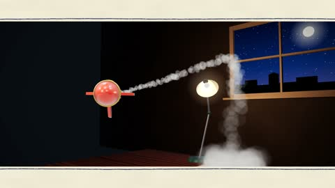

[← Back to gallery](../browse/motion.en.md) · [简体中文](2109738521829523925.md)

# Crayon Rocket Breaks Out of the Page

**[Ravi Annaswamy · @bag\_of\_ideas](https://x.com/bag_of_ideas)** · Motion design · 16s

> Discovery pool · Source verified; catalog details being completed.

**[▶ Open gallery to play](https://guanmo-ai.github.io/awesome-ai-motion/?lang=en#case-2109738521829523925)** · [Original post](https://x.com/bag_of_ideas/status/2109738521829523925)

Click the cover to open the gallery and play.

A flat rocket drawing becomes a toy, breaks through the page and dives back in.

No public prompt has been verified. [View the original post](https://x.com/bag_of_ideas/status/2109738521829523925)

Bookmarks — · Likes — · Views —

## Source record

- Original post: [@bag\_of\_ideas](https://x.com/bag_of_ideas/status/2109738521829523925) · 2026-10-12T20:10:35+00:00
- Model attribution: Claude Opus 5.5 · [Creator’s statement](https://x.com/bag_of_ideas/status/2109738521829523925)
- Prompt lookup: [Creator post](https://x.com/bag_of_ideas/status/2109738521829523925) · 2026-11-03 09:18 UTC
- Cover source: [Original cover source](https://x.com/bag_of_ideas/status/2109738521829523925) · 11.05s
- Metrics snapshot: [Original X post](https://x.com/bag_of_ideas/status/2109738521829523925) · 2026-11-03 08:38 UTC
- Gallery video source: [Original post media record](https://x.com/bag_of_ideas/status/2109738521829523925) · 2026-11-03 09:18 UTC · Post/media correspondence and media response checked; external reference, no re-upload

Model attribution is based on creator statements. Prompts have not been independently rerun; sound and visuals have not received a uniform quality rating. Videos reference original post media, not our uploads; redistribution permission has not been verified.
