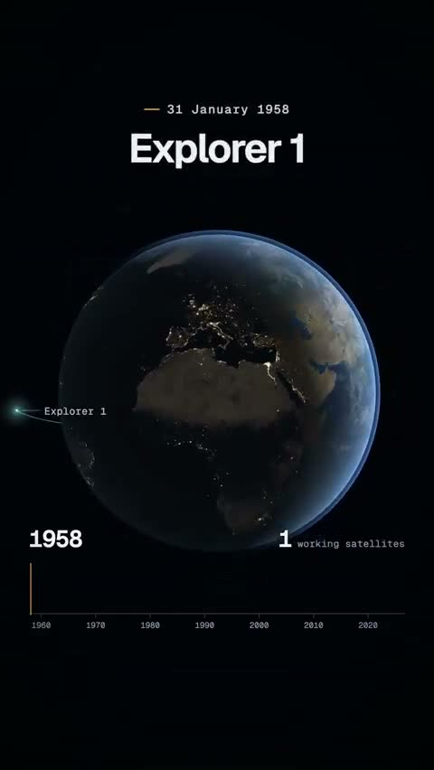

[← Back to gallery](../browse/education.en.md) · [简体中文](2109753917751849067.md)

# Sixty-Nine Years of Satellites

**[Elwynn Chen · @ob12er](https://x.com/ob12er)** · Education & explainers · 80s

> Discovery pool · Source verified; catalog details being completed.

**[▶ Open gallery to play](https://guanmo-ai.github.io/awesome-ai-motion/?lang=en#case-2109753917751849067)** · [Original post](https://x.com/ob12er/status/2109753917751849067)

Click the cover to open the gallery and play.

Dots, orbits and changing dates visualize satellite history.

No public prompt has been verified. [View the original post](https://x.com/ob12er/status/2109753917751849067)

Bookmarks 0 · Likes 1 · Views 264

## Source record

- Original post: [@ob12er](https://x.com/ob12er/status/2109753917751849067) · 2026-10-12T21:11:45+00:00
- Model attribution: Opus 5.5 · [Creator’s statement](https://x.com/ob12er/status/2109753917751849067)
- Prompt lookup: [Creator post](https://x.com/ob12er/status/2109753917751849067) · 2026-10-16 07:22 UTC
- Cover source: [Original cover source](https://x.com/ob12er/status/2109753917751849067) · 16s
- Metrics snapshot: [Original X post](https://x.com/ob12er/status/2109753917751849067) · 2026-10-16 07:22 UTC
- Gallery video source: [Original post media record](https://x.com/ob12er/status/2109753917751849067) · 2026-10-16 07:22 UTC · Post/media correspondence and media response checked; external reference, no re-upload

Model attribution is based on creator statements. Prompts have not been independently rerun; sound and visuals have not received a uniform quality rating. Videos reference original post media, not our uploads; redistribution permission has not been verified.
