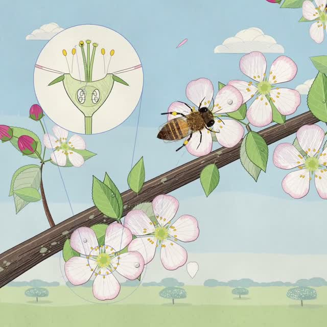

[← 返回图库](../browse/education.md) · [English](2109766087328100521.en.md)

# 一只蜜蜂的一生

**[Kevin Ngo · @kevin\_t\_ngo](https://x.com/kevin_t_ngo)** · 知识讲解 · 53s

> 发现池 · 来源已核对，编目资料待完善。

**[▶ 打开画廊播放](https://guanmo-ai.github.io/awesome-ai-motion/#case-2109766087328100521)** · [作者原帖](https://x.com/kevin_t_ngo/status/2109766087328100521)

点击封面打开画廊播放。

以蜂巢、飞行路线和花朵剖面展示蜜蜂的生命与授粉。作者说明画面逐帧使用 JavaScript 绘制。

未取得作者公开提示词。 [查看作者原帖](https://x.com/kevin_t_ngo/status/2109766087328100521)

收藏 236 · 点赞 604 · 浏览 17,921

## 来源记录

- 作品原帖: [@kevin\_t\_ngo](https://x.com/kevin_t_ngo/status/2109766087328100521) · 2026-10-12T22:00:07+00:00
- 模型归因: Claude Opus 5.5 / JavaScript · [作者说明](https://x.com/kevin_t_ngo/status/2109766087328100521)
- 提示词查阅记录: [作者原帖](https://x.com/kevin_t_ngo/status/2109766087328100521) · 2026-10-13 09:39 UTC
- 封面来源: [原帖封面来源](https://x.com/kevin_t_ngo/status/2109766087328100521) · 26.67s
- 互动快照: [X 原帖](https://x.com/kevin_t_ngo/status/2109766087328100521) · 2026-10-13 09:39 UTC
- 画廊原视频: [原帖媒体记录](https://x.com/kevin_t_ngo/status/2109766087328100521) · 2026-10-13 09:39 UTC · 已核对原帖媒体对应与媒体响应；外部引用，不重新上传

模型依据来自作者自述，未独立重跑提示词，也未对音画作统一质量评级。视频引用作者原帖媒体，未由本站重新上传，转载许可未确认。
