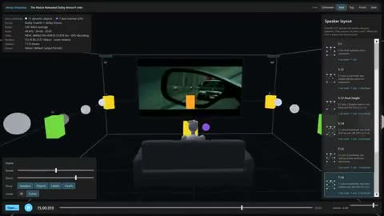

[← Back to gallery](../browse/education.en.md) · [简体中文](2109778453625020920.md)

# Visualizing Spatial Audio Positions in 3D

**[Christian Roman · @chroman](https://x.com/chroman)** · Education & explainers · 50s

> Discovery pool · Source verified; catalog details being completed.

**[▶ Open gallery to play](https://guanmo-ai.github.io/awesome-ai-motion/?lang=en#case-2109778453625020920)** · [Original post](https://x.com/chroman/status/2109778453625020920)

Click the cover to open the gallery and play.

Speakers, room outlines and moving sound sources visualize audio positions in a Unity project credited to Opus 5.5.

No public prompt has been verified. [View the original post](https://x.com/chroman/status/2109778453625020920)

Bookmarks 48 · Likes 107 · Views 8,527

## Source record

- Original post: [@chroman](https://x.com/chroman/status/2109778453625020920) · 2026-10-12T22:49:15+00:00
- Model attribution: Opus 5.5 · [Creator’s statement](https://x.com/chroman/status/2109778453625020920)
- Prompt lookup: [Creator post](https://x.com/chroman/status/2109778453625020920) · 2026-10-19 09:24 UTC
- Cover source: [Original cover source](https://x.com/chroman/status/2109778453625020920) · 10s
- Metrics snapshot: [Original X post](https://x.com/chroman/status/2109778453625020920) · 2026-10-19 09:24 UTC
- Gallery video source: [Original post media record](https://x.com/chroman/status/2109778453625020920) · 2026-10-19 09:24 UTC · Post/media correspondence and media response checked; external reference, no re-upload

Model attribution is based on creator statements. Prompts have not been independently rerun; sound and visuals have not received a uniform quality rating. Videos reference original post media, not our uploads; redistribution permission has not been verified.
