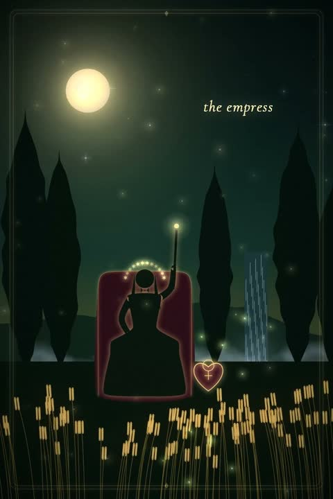

[← Back to gallery](../browse/stories.en.md) · [简体中文](2109820563359469960.md)

# The Fool's Journey in Animated Tarot Cards

**[sonder berry · @Midnightballoon](https://x.com/Midnightballoon)** · Narrative films · 123s

> Discovery pool · Source verified; catalog details being completed.

**[▶ Open gallery to play](https://guanmo-ai.github.io/awesome-ai-motion/?lang=en#case-2109820563359469960)** · [Original post](https://x.com/Midnightballoon/status/2109820563359469960)

Click the cover to open the gallery and play.

Cards, light and castle scenes connect in a tarot-themed journey.

No public prompt has been verified. [View the original post](https://x.com/Midnightballoon/status/2109820563359469960)

Bookmarks — · Likes — · Views —

## Source record

- Original post: [@Midnightballoon](https://x.com/Midnightballoon/status/2109820563359469960) · 2026-10-13T01:36:35+00:00
- Model attribution: Claude Opus 5.5 · [Creator’s statement](https://x.com/Midnightballoon/status/2109820563359469960)
- Prompt lookup: [Creator post](https://x.com/Midnightballoon/status/2109820563359469960) · 2026-11-02 09:52 UTC
- Cover source: [Original cover source](https://x.com/Midnightballoon/status/2109820563359469960) · 24.52s
- Metrics snapshot: [Original X post](https://x.com/Midnightballoon/status/2109820563359469960) · 2026-11-02 09:18 UTC
- Gallery video source: [Original post media record](https://x.com/Midnightballoon/status/2109820563359469960) · 2026-11-02 09:52 UTC · Post/media correspondence and media response checked; external reference, no re-upload

Model attribution is based on creator statements. Prompts have not been independently rerun; sound and visuals have not received a uniform quality rating. Videos reference original post media, not our uploads; redistribution permission has not been verified.
