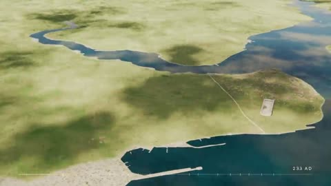

[← Back to gallery](../browse/education.en.md) · [简体中文](2109887700824125522.md)

# Istanbul History in Five Minutes of Animated Maps

**[JackTorrance · @Sherlock\_Hopes](https://x.com/Sherlock_Hopes)** · Education & explainers · 300s

> Discovery pool · Source verified; catalog details being completed.

**[▶ Open gallery to play](https://guanmo-ai.github.io/awesome-ai-motion/?lang=en#case-2109887700824125522)** · [Original post](https://x.com/Sherlock_Hopes/status/2109887700824125522)

Click the cover to open the gallery and play.

Maps, city scenes and time markers connect a history-themed film with a separate Suno score.

No public prompt has been verified. [View the original post](https://x.com/Sherlock_Hopes/status/2109887700824125522)

Bookmarks — · Likes — · Views —

## Source record

- Original post: [@Sherlock\_Hopes](https://x.com/Sherlock_Hopes/status/2109887700824125522) · 2026-10-13T06:03:22+00:00
- Model attribution: Claude Opus 5.5 · [Creator’s statement](https://x.com/Sherlock_Hopes/status/2109887700824125522)
- Prompt lookup: [Creator post](https://x.com/Sherlock_Hopes/status/2109887700824125522) · 2026-11-02 15:38 UTC
- Cover source: [Original cover source](https://x.com/Sherlock_Hopes/status/2109887700824125522) · 60.01s
- Metrics snapshot: [Original X post](https://x.com/Sherlock_Hopes/status/2109887700824125522) · 2026-11-02 15:05 UTC
- Gallery video source: [Original post media record](https://x.com/Sherlock_Hopes/status/2109887700824125522) · 2026-11-02 15:38 UTC · Post/media correspondence and media response checked; external reference, no re-upload

Model attribution is based on creator statements. Prompts have not been independently rerun; sound and visuals have not received a uniform quality rating. Videos reference original post media, not our uploads; redistribution permission has not been verified.
