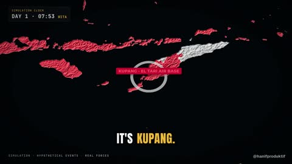

[← Back to gallery](../browse/education.en.md) · [简体中文](2109918956358357339.md)

# A Hypothetical Australia–Bali Conflict on a Map

**[Hanif \| AI For Productivity · @hanifproduktif](https://x.com/hanifproduktif)** · Education & explainers · 205s

> Discovery pool · Source verified; catalog details being completed.

**[▶ Open gallery to play](https://guanmo-ai.github.io/awesome-ai-motion/?lang=en#case-2109918956358357339)** · [Original post](https://x.com/hanifproduktif/status/2109918956358357339)

Click the cover to open the gallery and play.

Regional colors, routes, time markers and chapter titles advance across a map in the creator's fictional conflict scenario.

No public prompt has been verified. [View the original post](https://x.com/hanifproduktif/status/2109918956358357339)

Bookmarks — · Likes 1,068 · Views —

## Source record

- Original post: [@hanifproduktif](https://x.com/hanifproduktif/status/2109918956358357339) · 2026-10-13T08:07:34+00:00
- Model attribution: Claude Opus 5.5 · [Creator’s statement](https://x.com/hanifproduktif/status/2109918956358357339)
- Prompt lookup: [Creator post](https://x.com/hanifproduktif/status/2109918956358357339) · 2026-10-26 16:20 UTC
- Cover source: [Original cover source](https://x.com/hanifproduktif/status/2109918956358357339) · 41s
- Metrics snapshot: [Original X post](https://x.com/hanifproduktif/status/2109918956358357339) · 2026-10-26 14:57 UTC
- Gallery video source: [Original post media record](https://x.com/hanifproduktif/status/2109918956358357339) · 2026-10-26 16:20 UTC · Post/media correspondence and media response checked; external reference, no re-upload

Model attribution is based on creator statements. Prompts have not been independently rerun; sound and visuals have not received a uniform quality rating. Videos reference original post media, not our uploads; redistribution permission has not been verified.
