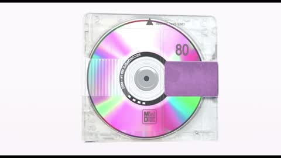

[← Back to gallery](../browse/interactive.en.md) · [简体中文](2109976621822497160.md)

# A MiniDisc Case Opens and Plays

**[white-house.eth · @white\_house\_eth](https://x.com/white_house_eth)** · 3D & interactive · 37s

> Discovery pool · Source verified; catalog details being completed.

**[▶ Open gallery to play](https://guanmo-ai.github.io/awesome-ai-motion/?lang=en#case-2109976621822497160)** · [Original post](https://x.com/white_house_eth/status/2109976621822497160)

Click the cover to open the gallery and play.

A transparent lid, disc and latch open and rotate in a 3D product-motion study.

No public prompt has been verified. [View the original post](https://x.com/white_house_eth/status/2109976621822497160)

Bookmarks — · Likes — · Views —

## Source record

- Original post: [@white\_house\_eth](https://x.com/white_house_eth/status/2109976621822497160) · 2026-10-13T11:56:42+00:00
- Model attribution: Claude Opus 5.5 · [Creator’s statement](https://x.com/white_house_eth/status/2109976621822497160)
- Prompt lookup: [Creator post](https://x.com/white_house_eth/status/2109976621822497160) · 2026-11-02 15:38 UTC
- Cover source: [Original cover source](https://x.com/white_house_eth/status/2109976621822497160) · 7.34s
- Metrics snapshot: [Original X post](https://x.com/white_house_eth/status/2109976621822497160) · 2026-11-02 15:08 UTC
- Gallery video source: [Original post media record](https://x.com/white_house_eth/status/2109976621822497160) · 2026-11-02 15:38 UTC · Post/media correspondence and media response checked; external reference, no re-upload

Model attribution is based on creator statements. Prompts have not been independently rerun; sound and visuals have not received a uniform quality rating. Videos reference original post media, not our uploads; redistribution permission has not been verified.
